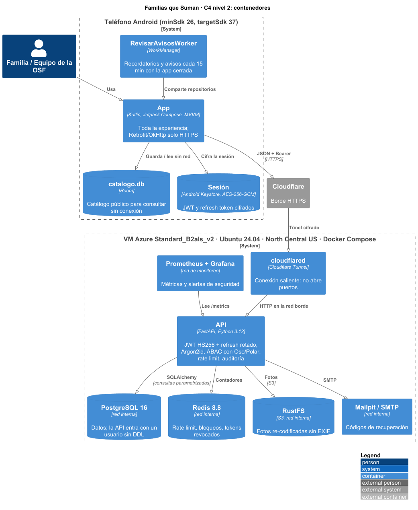
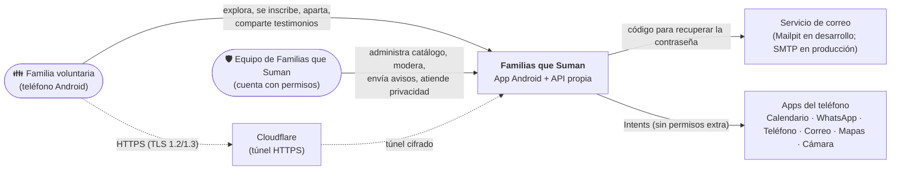
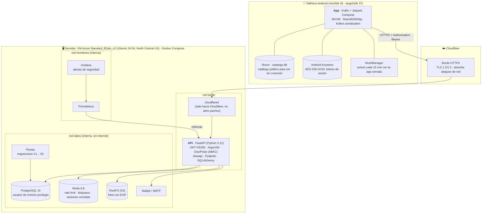
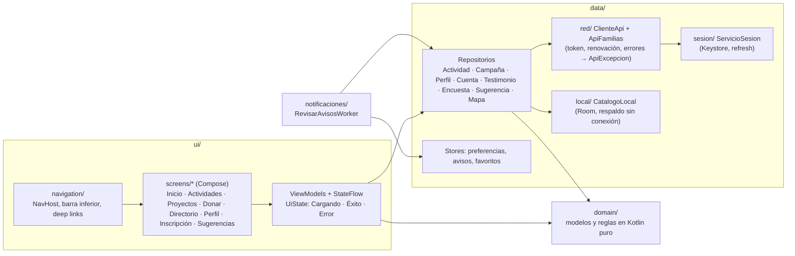
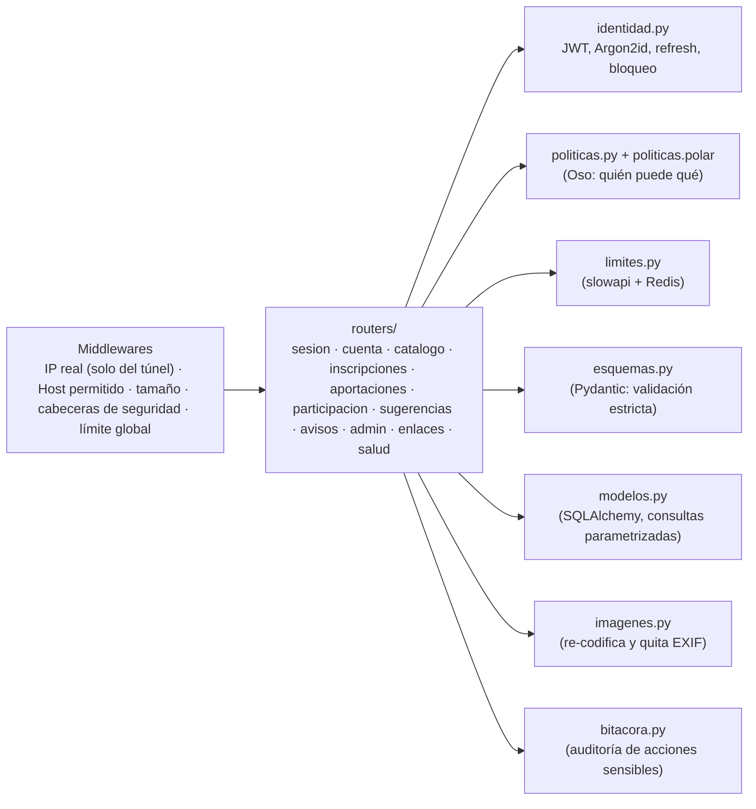
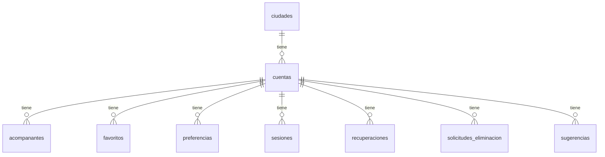
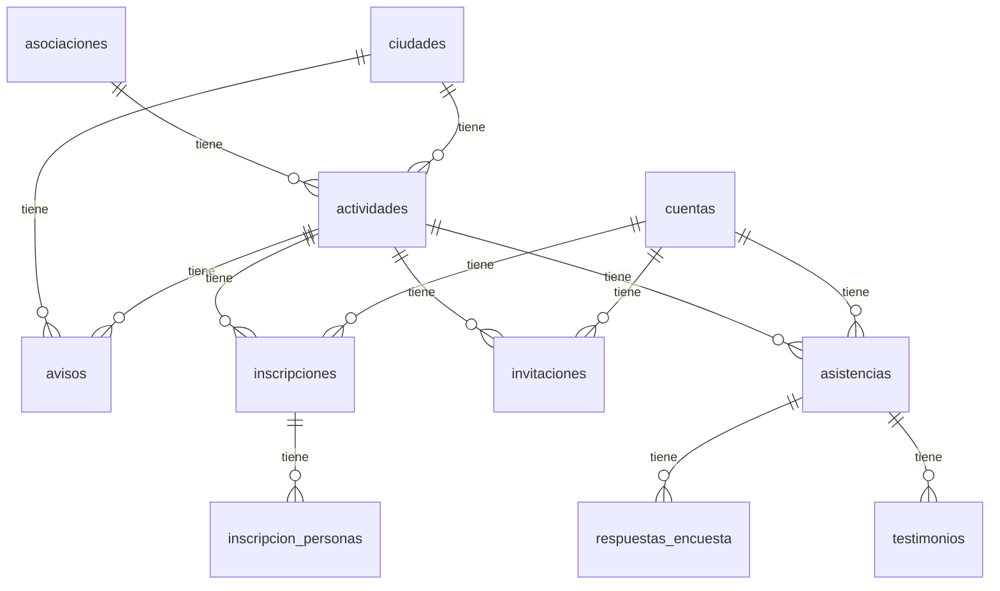
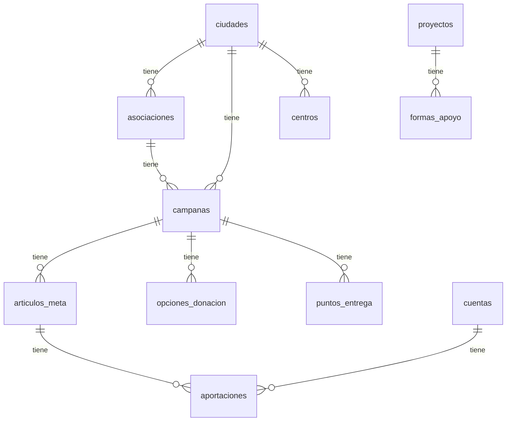

# 2. Arquitectura final del sistema

Modelo C4 en tres niveles: contexto, contenedores y componentes. Hay dos versiones:

- **Para el documento:** imágenes en `docs/entrega-3/img/`, generadas con C4-PlantUML desde
  `docs/entrega-3/diagramas/*.puml`:
  ```bash
  java -jar plantuml.jar -tpng -o ../img docs/entrega-3/diagramas/*.puml
  ```
- **Para leer en GitHub:** las de abajo, en Mermaid (GitHub las dibuja solas).



## 2.1 Nivel 1 · Contexto



- **Quién lo usa:** familias de Monterrey y Hermosillo (sin cuenta para explorar; con cuenta para
  inscribirse) y el equipo de Familias que Suman (cuentas con permisos firmados en su token).
- **Qué no hace:** no procesa pagos, no tiene mensajería entre familias, no usa Firebase ni Google
  Play Services, no rastrea la ubicación.

## 2.2 Nivel 2 · Contenedores



| Contenedor | Tecnología | Responsabilidad |
|---|---|---|
| App | Kotlin, Compose, Material 3 | Toda la experiencia de la familia y de la administración; guarda el catálogo público (Room) y la sesión cifrada (Keystore) |
| cloudflared | Cloudflare Tunnel | Única puerta desde internet; conexión saliente, sin puertos abiertos en el servidor |
| API | FastAPI | Identidad (registro, inicio, refresh rotado, cierre, recuperación), autorización ABAC, catálogo, inscripciones con cupo atómico, campañas, testimonios con revisión, encuestas, avisos, privacidad, auditoría |
| PostgreSQL | 16 | Datos de negocio; la API entra con un usuario sin permisos de DDL |
| Redis | 8.8 | Contadores de rate limit, bloqueo por fuerza bruta, tokens revocados |
| RustFS | S3 compatible | Fotos de perfil y testimonios, ya reducidas y sin metadatos |
| Flyway | 11 | Esquema versionado (`backend/db/migrations`) |
| Mailpit / SMTP | — | Código de 6 dígitos para recuperar la contraseña |
| Prometheus + Grafana | — | Métricas y alertas (picos de 401/403/429, entradas inválidas) |

## 2.3 Nivel 3 · Componentes de la app



## 2.4 Nivel 3 · Componentes de la API



## 2.5 Decisiones técnicas principales

La bitácora completa, con fecha y razón de cada una, está en [`docs/bitacora.md`](../bitacora.md).

| Decisión | Alternativa descartada | Por qué |
|---|---|---|
| Android nativo con Kotlin y Jetpack Compose, una sola base de código | Multiplataforma | Lo del curso; acceso directo a WorkManager, Keystore e Intents; el alcance se acotó a Android |
| API propia en FastAPI con PostgreSQL, todo en Docker Compose | Backend como servicio (Firebase) | Control de los datos de menores, reproducible por cualquiera con `docker compose up`, sin cuentas externas |
| Identidad propia: JWT HS256 de 15 min + refresh token de 30 días rotado y de un solo uso | Auth0 (se usó del 13 al 15 de oct) | La guía de clase (s23) pide JWT propio; sin servicio externo que configurar; detecta el reuso de un refresh robado |
| Contraseñas con Argon2id y bloqueo de 15 min tras 5 fallos por correo | BCrypt / solo límite por IP | Primera opción de OWASP; un bot con muchas IP igual se frena |
| Autorización ABAC con Oso (Polar) | Roles fijos en cada ruta | Las reglas dependen de quién es dueño y de cuándo (12 h antes, edad mínima); quedan en un solo archivo revisable |
| Cupo con `SELECT … FOR UPDATE` dentro de la transacción | Contar en la app | Dos familias por el último lugar: solo una lo obtiene (RF-05) |
| Fotos a un almacén S3 (RustFS), re-codificadas sin EXIF | Guardarlas en la base / MinIO | La base solo guarda la clave; MinIO comunitario dejó de recibir parches |
| Avisos con WorkManager cada 15 min, sin Firebase | FCM | Práctica 8: sin cuentas de Google ni otra llave privada; el aviso de privacidad no tiene que declarar a Google. Costo: hasta ~15 min de retraso |
| Catálogo público guardado con Room para verlo sin conexión | Guardar todo, o nada | Consulta de fichas sin conexión (RF-29) sin guardar datos personales en el teléfono |
| Salida a internet por Cloudflare Tunnel | Abrir puertos / IP pública | HTTPS sin abrir puertos; la red de Cloudflare absorbe ataques de red |
| Servidor en una VM de Azure for Students (2 vCPU, 4 GB) | Oracle Cloud Always Free (rechazó la tarjeta en dos cuentas); Render/Railway (se duermen) | Sin tarjeta ni costo (crédito de estudiante), no se duerme y corre el mismo `docker compose`. La política de la suscripción solo permite regiones fuera de México: se eligió la más cercana y se declara en el aviso |
| Explorar sin cuenta; la cuenta se pide al inscribirse (registro diferido) | Pedir cuenta al abrir | RF-18: menos fricción y menos datos de quien solo mira |
| Donación solo informativa | Pagos en línea | Indicación de la socia; no se manejan datos de pago |

## 2.6 Modelo de datos (entidad-relación)

Las 27 tablas de PostgreSQL, creadas por las migraciones Flyway `V1` a `V11`
(`backend/db/migrations/`), en tres diagramas para que se lean. Cada línea es una llave foránea,
«uno a muchos» de la tabla de la izquierda a la de la derecha. `cuentas` y `ciudades` son el centro:
casi todo lo que la familia hace cuelga de su cuenta, y todo el catálogo público se filtra por
ciudad. Los atributos no se dibujan; están en la [Guía del backend](../guia-backend.md) (§5) y en
las migraciones.

**a) La familia y su cuenta**



**b) Actividades y participación**



**c) Catálogo y donaciones**



La tabla `auditoria` no tiene llaves foráneas a propósito: guarda quién hizo qué con la identidad
seudonimizada (HMAC de la IP), de modo que borrar una cuenta no obliga a borrar su rastro de
seguridad.
