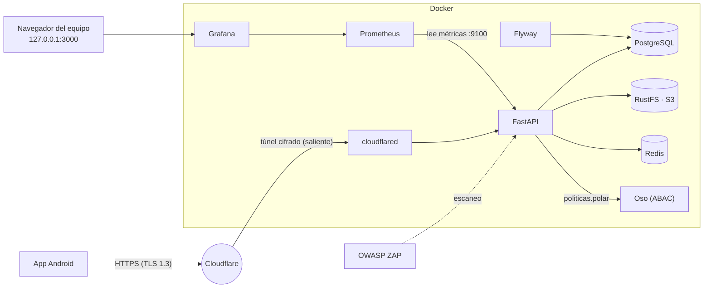
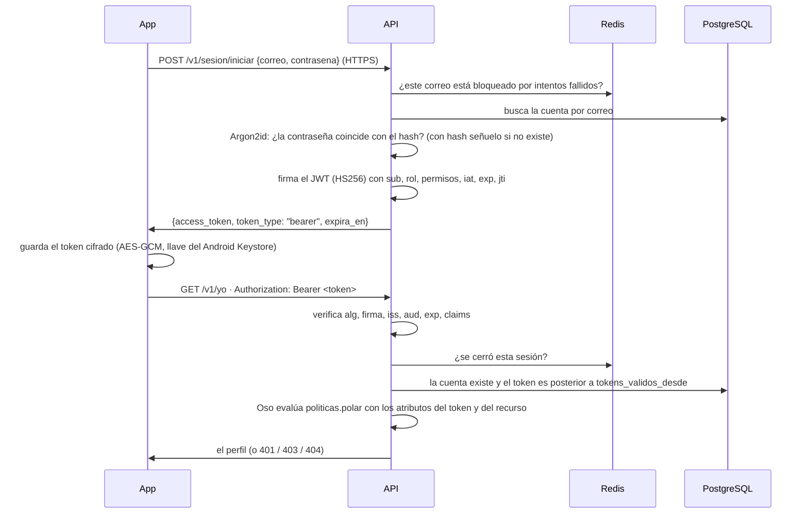

# Guía del backend · Familias que Suman

Manual completo del servidor de la app: qué es cada pieza, cómo se levanta, cómo se conecta la
app, y **cada medida de seguridad** con su nombre, qué es, de qué protege, cómo protege, dónde
está (archivo y línea, o contenedor) y por qué se decidió así.

> Todas las rutas de archivo son relativas a la raíz del repositorio. Las líneas citadas
> corresponden al commit donde se escribió esta guía; si alguien mueve código, el nombre de la
> función sigue siendo la referencia.

---

## Índice

1. [Resumen en una página](#1-resumen-en-una-página)
2. [La arquitectura: del pizarrón a los contenedores](#2-la-arquitectura-del-pizarrón-a-los-contenedores)
3. [Cómo levantarlo, paso a paso](#3-cómo-levantarlo-paso-a-paso)
4. [Identidad y autorización con JWT](#4-identidad-y-autorización-con-jwt)
5. [Cada componente a detalle](#5-cada-componente-a-detalle)
6. [La API: inventario de endpoints](#6-la-api-inventario-de-endpoints)
7. [Catálogo de medidas de seguridad (S-01 … S-40)](#7-catálogo-de-medidas-de-seguridad)
8. [Matrices: OWASP Top 10, API Top 10, CWE Top 25 y las clases](#8-matrices)
9. [La app Android: qué cambió y cómo se configura](#9-la-app-android)
10. [Enlaces que abren la app (App Links)](#10-enlaces-que-abren-la-app)
11. [Monitoreo: Prometheus, Grafana y alertas](#11-monitoreo)
12. [Pruebas automáticas](#12-pruebas-automáticas)
13. [OWASP ZAP: el escaneo y sus resultados](#13-owasp-zap)
14. [Operación: producción, secretos, respaldos y problemas comunes](#14-operación)
15. [Riesgos aceptados y siguientes pasos](#15-riesgos-aceptados-y-siguientes-pasos)
16. [Glosario](#16-glosario)
17. [Referencias](#17-referencias)

---

## 1. Resumen en una página

**Qué es:** una API REST hecha con **FastAPI** (Python 3.12) que sirve todo lo que muestra la app:
catálogo (actividades, asociaciones, campañas, proyectos, centros), la cuenta de cada familia
(perfil, acompañantes, favoritos, foto), inscripciones con cupo, historial, testimonios con foto,
encuestas, aportaciones a campañas, sugerencias, privacidad y administración.

**Con qué:**

| Pieza | Tecnología | Para qué |
|---|---|---|
| API | FastAPI + SQLAlchemy + Pydantic | La lógica y las reglas de negocio y de seguridad |
| Base de datos | PostgreSQL 16 | Los datos |
| Migraciones | Flyway 11 | Crear y cambiar las tablas en orden, versionado en Git |
| Fotos | RustFS (compatible con S3) | Fotos de perfil y de testimonios |
| Contadores | Redis 8.8 | Rate limit, intentos fallidos de inicio de sesión y sesiones cerradas |
| Identidad | **JWT propio** (PyJWT, HS256) + **Argon2id** | Registro, inicio de sesión, hash de contraseñas, emisión y verificación de tokens |
| Autorización | **Oso** (reglas en Polar) | Políticas ABAC declarativas con los atributos del token |
| Salida a internet | Cloudflare Tunnel (`cloudflared`) | HTTPS público sin abrir puertos |
| Monitoreo | Prometheus 3.15 + Grafana 13.2 | Métricas, alertas de seguridad, tablero |
| Escaneo | OWASP ZAP 2.17 | Ataque automático a la API |
| Pruebas | pytest | 147 pruebas contra la base, Redis y el almacén reales |

**Números de esta entrega:**

- **69 operaciones** documentadas en OpenAPI (más la página pública de invitación y `assetlinks.json`).
- **147 pruebas automáticas** de la API, todas en verde (§12).
- **OWASP ZAP, sin y con sesión: 0 alertas altas, 0 medias, 0 bajas** (1 informativa) (§13).
- **40 medidas de seguridad** catalogadas (§7), mapeadas a OWASP Top 10 2025, OWASP API Top 10
  2023 y CWE Top 25 (§8).

**Para levantarlo:**

```bash
cd backend
docker compose up -d --build
```

---

## 2. La arquitectura: del pizarrón a los contenedores

### 2.1 El dibujo



### 2.2 Cada caja del pizarrón, y dónde quedó

| En el pizarrón | Qué es | Dónde está |
|---|---|---|
| **Docker** (el recuadro) | Todo el backend corre en contenedores, con un solo comando | `backend/docker-compose.yml` |
| **DB** | PostgreSQL 16 | servicio `db` (línea 32 del compose) |
| **S3** | Almacén de objetos compatible con S3: RustFS | servicio `almacen` (línea 86) |
| **Auth** (la flecha a DB) | La identidad la lleva la propia API: compara la contraseña contra el hash Argon2id de la DB y firma el JWT. Ya no hay servicio externo | `backend/api/app/identidad.py` y `routers/sesion.py` |
| La **cajita sin nombre** | Redis: contadores del rate limit, intentos fallidos y sesiones cerradas | servicio `redis` (línea 110) |
| **FastAPI** | La API | servicio `api` (línea 128), código en `backend/api/app/` |
| **Tunnel** | Cloudflare Tunnel | servicio `tunel` (línea 173, perfil `tunel`) |
| La **nube** junto al túnel | La red de Cloudflare (termina el TLS, absorbe DDoS) | — |
| El **teléfono** con señal | La app Android | `app/` |
| **Prom** | Prometheus | servicio `prometheus` (línea 213) |
| **GF** | Grafana | servicio `grafana` (línea 228) |
| El **monitor** fuera de Docker | Quien opera ve Grafana desde su máquina (`127.0.0.1:3000`) | — |
| **OWASP → FastAPI** | OWASP ZAP escanea la API | servicio `zap` (línea 258, perfil `zap`) y `backend/seguridad/zap/plan-zap.yaml` |

**La lista de la derecha del pizarrón:**

| Pizarrón | Qué se hizo | Medidas (§7) |
|---|---|---|
| **SQLi ⇒ PS, ORM** | Todas las consultas pasan por SQLAlchemy (ORM) y viajan como consultas parametrizadas (*prepared statements*). Cero SQL armado con texto. | S-01, S-02, S-03, S-15 |
| **AA ⇒ JWT** | Identificación con JWT HS256 que emite y verifica la API (`POST /v1/sesion/iniciar`, como el `/login` de s23) | S-04, S-18 |
| **AA ⇒ UUID** | Todos los identificadores son UUID v4 | S-05 |
| **AA ⇒ ABAC (políticas)** | Autorización por atributos con Oso: las reglas en Polar (`politicas.polar`), los atributos del sujeto salen del JWT | S-06, S-07 |
| **AA ⇒ Hashed Pw DB** | Las contraseñas viven en nuestra base **solo** como hash Argon2id con sal; la app no las guarda | S-08 |
| **BF ⇒ Rate limit** | Rate limit global por IP y por flujo/cuenta (slowapi + Redis); en el login además bloqueo por correo tras 5 fallos | S-09 |
| **Sec ⇒ HTTP Sec** | Encabezados de seguridad en cada respuesta, HSTS, CSP | S-10, S-12 |
| **OWASP ZAP ⇒ ✓ OK** | Escaneo activo sin y con sesión: 0 alertas altas, medias o bajas | S-11 |

### 2.3 Las redes (segmentación)

Los contenedores no están todos en la misma red. Cada uno está solo en las que necesita
(`backend/docker-compose.yml`, sección `networks:` al final):

| Red | Tipo | Quién está | Para qué |
|---|---|---|---|
| `borde` | normal, subred fija `172.31.250.0/24` | `api`, `tunel`, `zap` | Lo que da hacia afuera. El túnel tiene IP fija (`172.31.250.10`) para que la API sepa cuándo una petición viene de Cloudflare |
| `datos` | **interna** (`internal: true`) | `api`, `db`, `migrar`, `seed`, `almacen`, `redis`, `pruebas` | Los datos. Sin salida a internet ni entrada desde fuera |
| `monitoreo` | **interna** | `api`, `tunel`, `prometheus`, `grafana` | Métricas. Tampoco tiene salida |
| `local` | normal | `almacen`, `prometheus`, `grafana` | Solo para publicar sus consolas en `127.0.0.1` |

Consecuencia: aunque alguien tomara control del contenedor del túnel, **no podría ni ver** la base
de datos, Redis ni el almacén, porque no comparte red con ellos. Es *defensa en profundidad* y
*zero trust* (clase de defensa holística, s22).

### 2.4 Qué se publica y qué no

| Puerto | Dónde | Quién llega |
|---|---|---|
| API `8000` | `127.0.0.1:8000` | Tu máquina y el emulador (`10.0.2.2`). Internet solo por el túnel |
| Métricas `9100` | solo red `monitoreo` | Prometheus. **No** pasa por el túnel |
| PostgreSQL `5432` | **no se publica** | Nadie fuera de Docker (`docker compose exec db psql …`) |
| Redis `6379` | **no se publica** | Solo la API |
| RustFS `9000/9001` | `127.0.0.1` | Tu navegador (consola). La app nunca habla con el almacén |
| Prometheus `9090` | `127.0.0.1` | Tu navegador |
| Grafana `3000` | `127.0.0.1` | Tu navegador, con usuario y contraseña |

---

## 3. Cómo levantarlo, paso a paso

### 3.1 Requisitos

- Docker Desktop (con espacio en disco: el disco virtual de Docker crece con las imágenes; si tu
  C: anda justo, en *Settings → Resources → Advanced → Disk image location* muévelo a otra unidad).
- Para la app: Android Studio.

### 3.2 Primer arranque

```bash
cd backend
cp .env.example .env        # opcional; sin .env usa valores de desarrollo
docker compose up -d --build
```

Qué pasa, en orden (`depends_on` del compose):

1. `db` arranca y espera a estar sano (`pg_isready`).
2. `migrar` (Flyway) aplica `V1…V7` y después `afterMigrate.sql` (crea/actualiza el usuario de
   mínimo privilegio de la API). Termina.
3. `seed` carga los datos de prueba. Termina.
4. `almacen` (RustFS) y `redis` arrancan con su *healthcheck*.
5. `api` arranca cuando lo anterior está listo. Al iniciar: configura la bitácora JSON, revisa que
   en producción no haya secretos de ejemplo, crea el bucket si falta y abre el puerto de métricas.
6. `prometheus` y `grafana`.

Comprueba:

```bash
curl http://localhost:8000/v1/salud               # {"estado":"ok"}
curl http://localhost:8000/v1/actividades         # el catálogo
```

Y en el navegador: `http://localhost:8000/docs` (solo en desarrollo), `http://localhost:3000`
(Grafana), `http://localhost:9090/alerts` (Prometheus).

### 3.3 Variables de entorno (`backend/.env`)

Todas están explicadas en `backend/.env.example`. Las importantes:

| Variable | Qué es | Notas |
|---|---|---|
| `ENTORNO` | `desarrollo` o `produccion` | En producción la API **no arranca** con secretos de ejemplo (S-17) y no publica `/docs` |
| `POSTGRES_USER/PASSWORD` | Dueño de la base | Lo usan Flyway y el seed. **La API nunca lo recibe** |
| `DB_API_USUARIO/CONTRASENA` | El usuario con el que entra la API | Mínimo privilegio (S-15) |
| `JWT_SECRETO` | El secreto con que la API firma los tokens (HS256) | Mínimo 32 caracteres en producción y distinto de `HMAC_SECRETO` (§4.10) |
| `JWT_MINUTOS` | Cuánto dura una sesión | `1440` (un día) |
| `STORAGE_ROOT_USER/PASSWORD` | Llaves del almacén | |
| `REDIS_CONTRASENA` | Contraseña de Redis | |
| `HMAC_SECRETO` | Llave para seudonimizar IPs | Mínimo 32 caracteres en producción |
| `GRAFANA_USUARIO/CONTRASENA` | Acceso a Grafana | |
| `LIMITE_GLOBAL` | Peticiones por minuto por IP | `120/minute` |
| `ENLACES_BASE`, `APP_HUELLAS_SHA256`, `TUNNEL_TOKEN` | Enlaces y App Links con dominio propio | §10 |

Para generar secretos: `python -c "import secrets; print(secrets.token_urlsafe(32))"`.

### 3.4 Perfiles (lo que se corre a mano)

```bash
docker compose --profile tunel up -d                       # túnel HTTPS (Quick Tunnel)
docker compose logs tunel | grep trycloudflare             # la dirección pública
docker compose --profile pruebas run --rm --build pruebas  # pruebas automáticas
bash seguridad/zap/escanear.sh                             # escaneo de OWASP ZAP (sin y con sesión)
```

### 3.5 Datos de prueba

`backend/db/seed/dev.sql` carga lo que antes vivía en la app (`DatosDePrueba.kt`): 7
asociaciones, 11 actividades, 4 campañas, 8 proyectos, 5 centros, sugerencias, y la **Familia
Rodríguez** (`ana.rodriguez@correo.com`) con acompañantes, una inscripción, cuatro participaciones,
dos testimonios, una encuesta y una aportación.

- Las fechas de las actividades se calculan **desde hoy** (función `pg_temp.fecha`), así siempre
  hay actividades próximas y otras pasadas.
- El catálogo se **actualiza** en cada `up`; lo de la familia de prueba solo se agrega si no existe.
- Las cuentas de prueba entran con contraseña: `ana.rodriguez@correo.com` / `familia123` y
  `admin@correo.com` / `admin123` (§4.8). En la base solo queda su hash Argon2id.

### 3.6 Si vienes de la versión anterior

**De la versión con Auth0:** basta con `docker compose up -d --build`. La V7 agrega
`contrasena_hash`, `permisos` y `tokens_validos_desde`, quita `auth0_sub`, y el seed les pone
contraseña a las cuentas de prueba. Si en tu `.env` quedaron `AUTH0_*`, ya no se usan: bórralas y
agrega `JWT_SECRETO`.

**De antes de la V6:** la V6 cambia mucho el esquema (las contraseñas salen de la base) y el seed cambió sus datos. Para
empezar limpio en tu máquina: `docker compose down -v` y después `docker compose up -d --build`
(borra los datos locales). El servicio de fotos ahora se llama `almacen` y usa RustFS; el
contenedor viejo `almacenamiento` (MinIO) se quita con `docker compose up -d --remove-orphans`.

---

## 4. Identidad y autorización con JWT

Es el esquema de la guía de clase **s23 · "Stateless Identity: JWT Authentication in FastAPI"** y
**"Integrating JWT with ABAC"**, aplicado a la app: la API **emite** y **verifica** sus propios
tokens; no hay ningún servicio externo de identidad que configurar.

### 4.1 Por qué así

- **Lo que pide la guía.** Identificación con un `POST /login` que valida credenciales y regresa un
  JWT firmado; una dependencia que extrae y verifica el `Bearer` en cada petición
  (`get_current_user`); y la **autorización** con los atributos del token evaluados por Oso con
  reglas escritas en Polar.
- **Nunca confiar en un encabezado sin firma.** Un `x-user: admin` lo escribe cualquiera; un JWT
  no se puede alterar sin el secreto (s23 §3).
- **Sin estado.** La API no guarda sesiones: cada petición trae su token firmado y cualquier copia
  de la API lo puede verificar. Lo único que se guarda (en Redis) es la lista de tokens que se
  cerraron antes de vencer (S-18).

> **Historia:** la entrega anterior usaba Auth0 (Universal Login + JWT RS256). Se quitó porque iba
> un paso adelante de lo que se pedía y obligaba a configurar un tenant en la nube para poder
> entrar. Ver `docs/bitacora.md` (2026-10-15).

### 4.2 El flujo completo



### 4.3 Las rutas de sesión

| Método | Ruta | Qué hace | Límite |
|---|---|---|---|
| POST | `/v1/sesion/registro` | Crea la cuenta (`correo`, `contrasena`, `nombre_familia`, `acepta_aviso`) y responde el token: la familia queda dentro | 10/h por IP |
| POST | `/v1/sesion/iniciar` | Correo y contraseña → token. Es el `/login` de la guía | 10/min y 60/h por IP + bloqueo por correo |
| POST | `/v1/sesion/cerrar` | 🔑 El token deja de servir desde ya | |
| POST | `/v1/sesion/recuperar` | Pedir ayuda con la contraseña. Responde **202 siempre** | 5/h por IP |
| GET | `/v1/yo` | 🔑 El `/me` de la guía: quién soy según el token | |

La respuesta de `registro` e `iniciar` es la misma del `/login` de la guía, más la duración:

```json
{ "access_token": "eyJhbGciOiJIUzI1NiIs…", "token_type": "bearer", "expira_en": 86400 }
```

Código: `backend/api/app/routers/sesion.py`.

### 4.4 El token por dentro

```text
encabezado  {"alg": "HS256", "typ": "JWT"}
contenido   {"iss": "familias-que-suman-api", "aud": "familias-que-suman-app",
             "sub": "c0000000-0000-0000-0000-000000000002", "rol": "familia", "permisos": [],
             "iat": 1792049642.62, "exp": 1792136042, "jti": "e68b7abd…"}
firma       HMAC-SHA256(encabezado.contenido, JWT_SECRETO)
```

| Claim | Para qué |
|---|---|
| `iss` / `aud` | Quién lo emitió (esta API) y para quién es (la app). Se exigen al verificar |
| `sub` | El id (UUID) de la cuenta. **Nada de correo ni nombre**: el contenido de un JWT se puede leer (solo es Base64) |
| `rol`, `permisos` | Los **atributos del sujeto** que usan las políticas ABAC (como `department` y `clearance_level` en la guía) |
| `iat`, `exp` | Cuándo se emitió y cuándo vence (24 h por omisión, `JWT_MINUTOS`). `iat` lleva fracciones de segundo para que un cambio de contraseña invalide los tokens anteriores sin ventana |
| `jti` | Id único: dos tokens nunca son iguales |

Código: `identidad.emitir_token` y `identidad.verificar_token` (`backend/api/app/identidad.py`).

### 4.5 Contraseñas

- Se guardan **solo** como hash **Argon2id** (`cuentas.contrasena_hash`, migración V7), con sal al
  azar por cuenta y parámetros de OWASP (19 MiB de memoria, 2 pasadas): probar contraseñas contra
  una tabla robada cuesta memoria y tiempo, incluso con tarjetas gráficas. La base además exige con
  un `CHECK` que lo guardado empiece con `$argon2id$`.
- Al registrarse: mínimo 8 y máximo 128 caracteres, al menos 4 caracteres distintos, no una de las
  más comunes (`12345678`, `password`, `contraseña`…) y no igual al correo.
- Al entrar, la comparación se hace **siempre**, aunque el correo no exista (contra un hash señuelo):
  tarda lo mismo y la respuesta es la misma, así nadie averigua qué correos tienen cuenta.
- La app **no guarda** la contraseña: la manda una vez y se queda con el token.

### 4.6 Fuerza bruta

Dos frenos que se suman (`limites.py` e `identidad.SesionesCerradas`):

1. **Por IP:** 10 intentos por minuto y 60 por hora en `/v1/sesion/iniciar`.
2. **Por correo:** tras **5** contraseñas equivocadas seguidas, ese correo queda bloqueado
   **15 minutos** desde cualquier IP (`429 demasiados_intentos` con `Retry-After`). Frena a quien
   usa muchas IPs contra una sola cuenta. En Redis se guarda el SHA-256 del correo, no el correo.

Además, la alerta `FuerzaBrutaInicioSesion` de Prometheus avisa si hay más de 30 contraseñas
equivocadas en 5 minutos (§11).

### 4.7 Permisos (quién es admin)

Los cuatro permisos viven en la cuenta (`cuentas.permisos`, V7) y **viajan dentro del JWT**:

| Permiso | Qué deja hacer |
|---|---|
| `administrar:catalogo` | Crear, editar, duplicar y borrar asociaciones, actividades, campañas, proyectos y centros |
| `moderar:contenido` | Borrar testimonios ajenos, revisar sugerencias, ver respuestas de todas las familias |
| `registrar:asistencias` | Registrar que una familia asistió (arma el historial) |
| `atender:privacidad` | Ver y atender solicitudes de eliminación de datos |

- **Nadie se hace admin desde la app:** el registro siempre crea familias y el cuerpo no acepta
  campos como `permisos` o `rol` (422, S-22).
- Se dan desde el servidor (hay que tener acceso a Docker):

  ```bash
  docker compose exec api python -m app.herramientas permisos ana.rodriguez@correo.com todos
  docker compose exec api python -m app.herramientas permisos ana.rodriguez@correo.com registrar:asistencias
  docker compose exec api python -m app.herramientas permisos ana.rodriguez@correo.com ninguno
  ```

- Como los permisos van firmados en el token, cambiarlos **invalida los tokens anteriores** de esa
  cuenta (`tokens_validos_desde`): la persona vuelve a entrar y su nuevo token trae lo correcto.

### 4.8 Cuentas de prueba (solo desarrollo)

El seed (`backend/db/seed/dev.sql`) crea:

| Cuenta | Contraseña | Qué es |
|---|---|---|
| `ana.rodriguez@correo.com` | `familia123` | La Familia Rodríguez, con historial, testimonios, favoritos e inscripción |
| `admin@correo.com` | `admin123` | Administración, con los cuatro permisos |

En un servidor real no se carga el seed: las familias se registran desde la app.

### 4.9 "¿Olvidaste tu contraseña?"

El proyecto no manda correos. `POST /v1/sesion/recuperar` responde lo mismo exista o no el correo y,
si existe, deja la solicitud en la `auditoria` (`sesion.recuperar_solicitada`). El equipo la ve con:

```bash
docker compose exec db psql -U familias -d familias -c "select ocurrio_en, objeto_id from auditoria where accion = 'sesion.recuperar_solicitada' order by 1 desc"
```

y le pone una contraseña temporal (se escribe sin que se vea y no queda en el historial de la
terminal; cierra las sesiones abiertas de esa cuenta):

```bash
docker compose exec -it api python -m app.herramientas contrasena ana.rodriguez@correo.com
```

### 4.10 Configuración

`backend/.env` (ver `.env.example`):

```ini
JWT_SECRETO=<python -c "import secrets; print(secrets.token_urlsafe(48))">
JWT_MINUTOS=1440
```

`local.properties` (raíz del repo, no se sube a Git) solo necesita dónde está la API:

```properties
api.url=http://10.0.2.2:8000
```

El secreto **nunca** va en la app: con él se puede fabricar un token de administración.

### 4.11 Demostración como en la guía (s23 §5)

```bash
API=http://127.0.0.1:8000
ANA=$(curl -s -X POST $API/v1/sesion/iniciar -H "Content-Type: application/json" \
  -d '{"correo":"ana.rodriguez@correo.com","contrasena":"familia123"}' | jq -r .access_token)
ADMIN=$(curl -s -X POST $API/v1/sesion/iniciar -H "Content-Type: application/json" \
  -d '{"correo":"admin@correo.com","contrasena":"admin123"}' | jq -r .access_token)

curl -i -X POST $API/v1/sesion/iniciar -H "Content-Type: application/json" \
  -d '{"correo":"ana.rodriguez@correo.com","contrasena":"WrongPassword!"}'      # 401
curl -i $API/v1/yo                                                              # 401 falta_token
curl -s $API/v1/yo -H "Authorization: Bearer $ANA" | jq '{correo, es_admin, permisos}'
curl -i $API/v1/admin/encuestas -H "Authorization: Bearer $ANA"                 # 403: ABAC lo niega
curl -s -o /dev/null -w "%{http_code}\n" $API/v1/admin/encuestas -H "Authorization: Bearer $ADMIN"   # 200
```

**Resistencia a la alteración (§5.4 de la guía):** se decodifica el contenido del token de Ana, se
cambia `"permisos": []` por `["moderar:contenido"]` sin volver a firmar, y se manda:

```json
{"error": "Tu sesión no es válida. Vuelve a iniciar sesión.", "codigo": "token_invalido"}
```

La firma HMAC-SHA256 ya no coincide con el contenido alterado. Lo mismo prueba
`test_contenido_alterado_rompe_la_firma`.

---

## 5. Cada componente a detalle

### 5.1 `db` · PostgreSQL 16

- **Qué es:** la base de datos relacional.
- **Imagen:** `postgres:16` (etiqueta de versión mayor: recibe parches de seguridad al hacer `pull`).
- **Datos:** volumen `db-data`.
- **Seguridad:** sin puertos publicados; solo en la red interna `datos`; `no-new-privileges`;
  límite de memoria 512 MB. La API entra con un usuario restringido (§5.2, S-15).
- **Por qué PostgreSQL:** transacciones reales, `SELECT … FOR UPDATE` (S-19), tipos `uuid`,
  `jsonb`, arreglos, índices parciales y `CHECK` (la base también valida).

### 5.2 `migrar` · Flyway 11 y `afterMigrate.sql`

- **Qué es:** aplica las migraciones `backend/db/migrations/V*.sql` en orden y apunta en
  `flyway_schema_history` cuáles ya corrió.
- **Las migraciones:**

  | Archivo | Qué agrega |
  |---|---|
  | `V1__esquema_inicial.sql` | `cuentas`, `asociaciones`, `actividades`, `inscripciones` |
  | `V2__familia.sql` | foto, `acompanantes`, `favoritos`, `preferencias` |
  | `V3__participacion.sql` | `asistencias`, `testimonios`, `respuestas_encuesta`, `invitaciones` |
  | `V4__catalogo.sql` | `proyectos`, `formas_apoyo`, `centros`, `campanas`, `articulos_meta`, `aportaciones` |
  | `V5__sugerencias_y_privacidad.sql` | `sugerencias`, `solicitudes_eliminacion` |
  | `V6__api_completa.sql` | `ciudades`; cuentas con `auth0_sub` y **sin** `contrasena_hash` (la época de Auth0); todos los textos del sitio; `inscripcion_personas`; consentimiento de menores; opciones y puntos de entrega; `auditoria` |
  | **`V7__identidad_propia_jwt.sql`** | Vuelve `contrasena_hash` (**solo Argon2id**, con `CHECK`), `permisos` (solo los cuatro que existen), `tokens_validos_desde`; se va `auth0_sub` |

- **`afterMigrate.sql`** (callback de Flyway, corre después de cada `migrate`): crea el usuario
  `familias_api` con la contraseña que llega como *placeholder* (`FLYWAY_PLACEHOLDERS_API_CONTRASENA`),
  y le da **solo** `SELECT, INSERT, UPDATE, DELETE` en las tablas. Le quita `UPDATE/DELETE` en
  `auditoria` (línea 34) y todo en `flyway_schema_history`. Ver S-15.
- **Por qué Flyway:** el esquema queda en Git, cada cambio es un archivo nuevo, y es independiente
  del lenguaje de la API.

### 5.3 `seed` · datos de prueba

`postgres:16` corriendo `psql -f /seed/dev.sql` y termina. Solo desarrollo (§3.5).

### 5.4 `almacen` · RustFS (S3)

- **Qué es:** almacén de objetos que habla el protocolo de Amazon S3. Guarda las fotos.
- **Por qué RustFS y no MinIO:** la imagen comunitaria oficial de MinIO se **archivó** en 2026 y ya
  no recibe parches; usar componentes sin mantenimiento es OWASP A03/A06 (cadena de suministro,
  componentes vulnerables). RustFS es el mismo que se usó en la Práctica 11 y la API no cambia:
  habla S3 con `boto3` (`backend/api/app/almacen.py`). Con cambiar `S3_ENDPOINT` funciona igual con
  Amazon S3 o Cloudflare R2.
- **Seguridad:** red interna `datos`; la consola solo en `127.0.0.1`; el bucket es privado (sin
  política pública); **la app nunca habla con el almacén**: pide las fotos a la API, que revisa
  permisos (S-24). Las claves de los objetos las genera el servidor (`perfil/<32 hex>.jpg`,
  validadas con `CLAVE_VALIDA`, `almacen.py:28`).

### 5.5 `redis` · Redis 8.8

- **Qué es:** base en memoria, muy rápida.
- **Para qué:** (1) los contadores del rate limit (S-09), (2) los intentos fallidos de inicio de
  sesión por correo (§4.6) y (3) la lista de sesiones cerradas (S-18).
- **Seguridad:** contraseña (`--requirepass`) aunque esté en red interna (defensa en profundidad);
  `--maxmemory-policy noeviction`: si se llena, **no** olvida llaves (una sesión cerrada no puede
  "revivir" por falta de memoria); persistencia `--save 60 1`.

### 5.6 `api` · FastAPI

Imagen construida con `backend/api/Dockerfile`:

- Etapa **`produccion`**: Python 3.12 slim (Oso publica paquetes compilados hasta 3.12), dependencias **exactas** de `uv.lock` (con hashes), **sin**
  herramientas de prueba (`--no-dev`, línea 24), usuario sin privilegios `api` (UID 10001, línea
  18), *healthcheck*, y `uvicorn` con `--no-server-header`, `--limit-concurrency 200`,
  `--timeout-keep-alive 5` (línea 31).
- Etapa **`pruebas`**: lo mismo más pytest y las pruebas.

En el compose (línea 128): `read_only: true`, `tmpfs /tmp`, `cap_drop: ALL`,
`no-new-privileges`, 512 MB, 1 CPU, 256 procesos máximo, y **sin `env_file`** (recibe solo sus
variables; nunca la contraseña de dueño de la base).

**Los archivos de `backend/api/app/`:**

| Archivo | Qué hace |
|---|---|
| `main.py` | Arma la app: middlewares en orden, routers, documentación solo interna, arranque |
| `config.py` | Toda la configuración desde variables de entorno; revisión de producción |
| `db.py` | Conexión a PostgreSQL con tiempos límite |
| `modelos.py` | Las tablas como clases (ORM) |
| `esquemas.py` | Lo que entra y lo que sale (Pydantic): validación y respuestas explícitas |
| `identidad.py` | Emitir y verificar los JWT, hash Argon2id de contraseñas, bloqueo por fuerza bruta, sesiones cerradas, `usuario_actual` |
| `politicas.polar` | **Las reglas ABAC en Polar** (lo que se permite y por qué se niega) |
| `politicas.py` | Arma los recursos con sus atributos, le pregunta a Oso y traduce la negación al error de la app |
| `limites.py` | Rate limit (slowapi + middleware global propio) |
| `seguridad.py` | Middlewares: registro, encabezados, Host, tamaño de cuerpo, red de errores |
| `errores.py` | Forma única de errores; manejo de excepciones que falla cerrado |
| `bitacora.py` | Logs en JSON, HMAC de IPs, auditoría |
| `metricas.py` | Métricas de Prometheus, incluidos eventos de seguridad |
| `almacen.py` | El almacén S3 |
| `imagenes.py` | Validación y reescritura de fotos |
| `convertir.py` | De filas a respuestas: lugares, metas, zonas horarias |
| `herramientas.py` | Dar permisos y poner contraseña nueva (CLI dentro del contenedor, no HTTP) |
| `routers/sesion.py` | Registro, inicio de sesión (JWT), cerrar sesión, recuperar |
| `routers/catalogo.py` | Catálogo público y fotos |
| `routers/cuenta.py` | `/v1/yo/…`: perfil, acompañantes, favoritos, preferencias, foto, invitaciones, privacidad |
| `routers/inscripciones.py` | Inscribirse, modificar y cancelar (con candado) |
| `routers/participacion.py` | Historial, testimonios, encuestas, asistencias |
| `routers/aportaciones.py` | Apartar artículos de campañas (con candado e idempotencia) |
| `routers/sugerencias.py` | Sugerir (público) y bandeja de moderación |
| `routers/admin.py` | Administración del catálogo y de la privacidad |
| `routers/enlaces.py` | Enlace para compartir, página de invitación, `assetlinks.json` |
| `routers/salud.py` | Salud del servicio |

**El camino de una petición:**

```
Cloudflare → cloudflared → Registro → EncabezadosSeguridad → HostValido → LimiteCuerpo
          → LimiteGlobal → CapturarErrores → [ruta] → identidad (JWT) → límite por flujo
          → políticas ABAC (Oso + Polar) → ORM → PostgreSQL → respuesta (esquema de salida) → …de regreso
```

(`main.py:57-62`: la última capa que se agrega es la más externa.)

### 5.7 `tunel` · Cloudflare Tunnel

- **Qué es:** `cloudflared` abre una conexión **saliente** cifrada hacia Cloudflare. Cloudflare
  recibe el HTTPS del teléfono y lo manda por esa conexión a `http://api:8000`.
- **Por qué:** no se abre ningún puerto en el router ni se expone la IP de la máquina; el
  certificado TLS lo pone Cloudflare; y la red de Cloudflare absorbe ataques de red (SYN flood,
  UDP flood, s12) antes de que lleguen.
- **Quick Tunnel** (perfil `tunel`): sin cuenta, una dirección `https://<palabras>.trycloudflare.com`
  que **cambia cada vez**. `--metrics 0.0.0.0:2000` publica `/quicktunnel`, de donde la API lee su
  dirección pública para los enlaces (`routers/enlaces.py:44`).
- **Túnel con nombre** (perfil `tunel-nombrado`): con un dominio en Cloudflare, dirección fija
  (§10.3).
- **Seguridad:** IP fija `172.31.250.10` (la API solo le cree `CF-Connecting-IP` a esa IP, S-27);
  `read_only`, `cap_drop: ALL`; está en `borde` y `monitoreo`, **no** en `datos`.

### 5.8 `prometheus` y `grafana`

Ver §11.

### 5.9 `zap` · OWASP ZAP

Ver §13.

### 5.10 `pruebas`

Ver §12. Crea una base aparte (`familias_pruebas`) desde cero con las mismas migraciones, usa
Redis `/1` y el bucket `familias-pruebas`: no toca los datos de desarrollo.

---

## 6. La API: inventario de endpoints

Versión `v1` en la ruta (para poder cambiar sin romper apps viejas, OWASP API9). Inventario
completo y siempre al día en `http://localhost:8000/openapi.json` (solo desde la red interna).

**Formato de errores** (`errores.py`): siempre

```json
{ "error": "Texto para la persona", "codigo": "slug_para_la_app", "solicitud": "id-de-la-bitácora", "datos": {…} }
```

`401` trae `WWW-Authenticate: Bearer …`; `429` trae `Retry-After`.

**Leyenda:** 🌐 público · 🔑 con sesión · 🛡️ con permiso (claim `permisos` del JWT). "Límite": además del global
de 120/min por IP.

### 6.1 Catálogo y enlaces (públicos)

| Método | Ruta | Quién | Notas |
|---|---|---|---|
| GET | `/v1/salud` | 🌐 | `{"estado":"ok"}`. No dice versiones |
| GET | `/v1/ciudades` | 🌐 | Monterrey y Hermosillo, con zona horaria y centro del mapa |
| GET | `/v1/asociaciones?todas=&ciudad=` | 🌐 | Las del directorio (o todas) |
| GET | `/v1/asociaciones/{id}` | 🌐 | |
| GET | `/v1/actividades?ciudad=&cuando=` | 🌐 | Próximas primero; `lugares_disponibles` y `ya_paso` calculados en el servidor |
| GET | `/v1/actividades/{id}` | 🌐 | |
| GET | `/v1/actividades/{id}/enlace` | 🌐 | El enlace para invitar (§10) |
| GET | `/v1/campanas`, `/v1/campanas/{id}` | 🌐 | Con metas y lo apartado |
| GET | `/v1/proyectos`, `/v1/proyectos/{id}` | 🌐 | |
| GET | `/v1/centros`, `/v1/centros/{id}` | 🌐 | |
| GET | `/v1/testimonios` | 🌐 (🔑 opcional) | Sin correos. Con sesión dice `es_mio` |
| GET | `/v1/fotos/{carpeta}/{nombre}` | 🌐/🔑 | Testimonios: públicas. Perfil: solo su dueña |
| POST | `/v1/sugerencias` | 🌐 | **5 por hora por IP** |
| GET | `/a/{id}` | 🌐 | Página de invitación (HTML). 60/min |
| GET | `/.well-known/assetlinks.json` | 🌐 | App Links |
| POST | `/v1/sesion/registro`, `/v1/sesion/iniciar`, `/v1/sesion/recuperar` | 🌐 | §4.3. Responden el JWT (registro e iniciar) |

### 6.2 Mi cuenta (🔑)

| Método | Ruta | Límite |
|---|---|---|
| GET / PATCH | `/v1/yo` | PATCH: 60/h por cuenta |
| GET / POST | `/v1/yo/acompanantes` | 60/h |
| DELETE | `/v1/yo/acompanantes/{id}` | 60/h |
| GET | `/v1/yo/favoritos` | |
| PUT / DELETE | `/v1/yo/favoritos/{id}` | 60/h |
| GET / PUT | `/v1/yo/preferencias` | 60/h |
| GET / PUT / DELETE | `/v1/yo/foto` | PUT: 10/h |
| POST | `/v1/yo/invitaciones` | 60/h |
| GET / POST | `/v1/yo/eliminacion` | POST: 3 por día |
| POST | `/v1/sesion/cerrar` | |
| GET | `/v1/yo/inscripciones` | |
| PUT / DELETE | `/v1/yo/inscripciones/{actividad}` | 30/h |
| GET | `/v1/yo/historial`, `/v1/yo/testimonios`, `/v1/yo/encuestas` | |
| PUT | `/v1/yo/participaciones/{id}/testimonio` (multipart) | 10/h |
| DELETE | `/v1/testimonios/{id}` | autora o moderación |
| PUT | `/v1/yo/actividades/{id}/encuesta-previa` | 30/h |
| PUT | `/v1/yo/participaciones/{id}/encuesta-final` | 30/h |
| POST | `/v1/campanas/articulos/{id}/aportaciones` | 30/h |

### 6.3 Administración (🛡️)

| Método | Ruta | Permiso |
|---|---|---|
| POST, PUT, DELETE | `/v1/admin/asociaciones[/{id}]` | `administrar:catalogo` |
| POST, PUT, DELETE | `/v1/admin/actividades[/{id}]`, `POST …/{id}/duplicar` | `administrar:catalogo` |
| POST, PUT, DELETE | `/v1/admin/campanas[/{id}]` | `administrar:catalogo` |
| POST, PUT, DELETE | `/v1/admin/proyectos[/{id}]` | `administrar:catalogo` |
| POST, PUT, DELETE | `/v1/admin/centros[/{id}]` | `administrar:catalogo` |
| GET, PATCH | `/v1/admin/sugerencias[/{id}]` | `moderar:contenido` |
| GET | `/v1/admin/encuestas?actividad_id=` | `moderar:contenido` |
| POST | `/v1/admin/asistencias` | `registrar:asistencias` |
| GET | `/v1/admin/solicitudes-eliminacion` | `atender:privacidad` |
| POST | `/v1/admin/solicitudes-eliminacion/{id}/atender` | `atender:privacidad` |

Todas con 300/h por cuenta y **auditadas** (S-31).

### 6.4 Ejemplos

```bash
# Público
curl -s http://localhost:8000/v1/actividades?cuando=proximas

# Entrar (el token lo da la API)
TOKEN=$(curl -s -X POST http://localhost:8000/v1/sesion/iniciar -H "Content-Type: application/json" \
  -d '{"correo":"ana.rodriguez@correo.com","contrasena":"familia123"}' | jq -r .access_token)

# Con sesión
curl -s -H "Authorization: Bearer $TOKEN" http://localhost:8000/v1/yo

# Inscribirse con un acompañante menor (requiere consentimiento)
curl -s -X PUT -H "Authorization: Bearer $TOKEN" -H "Content-Type: application/json" \
  -d '{"acompanantes":[{"nombre":"Mateo Rodríguez","fecha_nacimiento":"2017-03-14"}],"consentimiento_menores":true}' \
  http://localhost:8000/v1/yo/inscripciones/d0000000-0000-0000-0000-000000000002
```

---

## 7. Catálogo de medidas de seguridad

Cada medida tiene: **qué es**, **de qué protege**, **cómo protege**, **dónde está**, **por qué
así** y **cómo se comprueba**.

### Del pizarrón

#### S-01 · Consultas parametrizadas (prepared statements)

- **Qué es:** el texto de la persona viaja a PostgreSQL **separado** de la consulta, como dato.
- **De qué protege:** inyección SQL (OWASP A05:2025 · CWE-89 · s15 "the power of `';`").
- **Cómo:** en vez de `f"… WHERE titulo = '{entrada}'"`, el driver manda
  `… WHERE titulo = $1` y aparte el valor. Aunque el valor sea `'; DROP TABLE cuentas; --`, nunca
  se ejecuta: se compara como texto.
- **Dónde:** todas las consultas (SQLAlchemy + psycopg 3). En el código **no existe un solo
  f-string con SQL** (`backend/api/app/db.py`, comentario de arriba).
- **Por qué:** es la defensa principal que pide la clase (s22, "Parameterized Queries").
- **Comprobación:** `tests/test_entradas.py` manda 5 cargas de SQLi en filtros, ids y cuerpos;
  `test_sqli_en_el_cuerpo_se_guarda_como_texto` comprueba que el texto se guardó literal y que la
  tabla `cuentas` sigue existiendo. ZAP corrió sus reglas de SQLi (40018-40022): 0 hallazgos.

#### S-02 · ORM (SQLAlchemy)

- **Qué es:** las tablas son clases de Python y las consultas se arman con objetos
  (`select(Actividad).where(Actividad.id == x)`).
- **De qué protege:** SQLi (los parámetros siempre van separados), errores de tipo.
- **Dónde:** `backend/api/app/modelos.py` (tablas) y cada router.
- **Por qué:** es la tercera opción de s22 ("Use frameworks like SQLAlchemy that handle
  parameterization automatically") y la que usamos en la Práctica 11.

#### S-03 · Validación de entradas (Pydantic y patrones)

- **Qué es:** cada dato que entra tiene tipo, largo máximo, rango y formato declarados.
- **De qué protege:** entradas maliciosas o absurdas (CWE-20), inyección, errores 500 por datos
  raros (un `\x00` rompe PostgreSQL), *log injection*.
- **Cómo:** `esquemas.py`: textos con tope y sin caracteres de control (`_sin_control`, línea 30);
  números con `ge/le`; fechas **con zona horaria** obligatoria; teléfonos solo dígitos; correos con
  patrón; enlaces de Instagram/Facebook solo `https://` de dominios permitidos (`_enlace_seguro`,
  línea 56; evita `javascript:` e `intent:` que la app abriría); listas con máximo de elementos.
  Los filtros de búsqueda tienen patrón (`FiltroCiudad` en `routers/catalogo.py`). Los ids son
  `uuid.UUID`: lo que no es UUID se rechaza antes de tocar la base.
- **Comprobación:** `test_entradas.py` (caracteres de control, topes, rangos, fechas sin zona,
  enlaces inseguros).

#### S-04 · JWT HS256 que emite y verifica la propia API

- **Qué es:** el token es un JWT (`encabezado.contenido.firma`, s22/s23) firmado por la API con
  HMAC-SHA256 y un secreto que solo ella tiene (`JWT_SECRETO`). Lo da `POST /v1/sesion/iniciar`
  (el `/login` de la guía) y se verifica en cada petición en `usuario_actual` (el
  `get_current_user` de la guía).
- **De qué protege:** suplantación de identidad, tokens falsificados o alterados (OWASP A07 ·
  API2 · CWE-287), y confiar en un encabezado sin firma (`x-user`, s23 §3).
- **Cómo** (`identidad.verificar_token`):
  1. Largo máximo y tres partes.
  2. `alg` debe ser **exactamente HS256**: cierra `alg: none` y que quien llama elija el algoritmo
     (ni siquiera HS512 con el secreto correcto pasa).
  3. `jwt.decode` revisa la firma con el secreto, `iss` (esta API), `aud` (la app), `exp`/`iat` con
     30 s de tolerancia, y **exige** `exp, iat, iss, aud, sub, jti`.
  4. Aunque la firma sea buena, se revisa la forma: `sub` es UUID, `rol` es `familia`/`admin`,
     `permisos` es una lista de los cuatro permisos que existen.
  5. Después: que no sea una sesión cerrada (S-18), que la cuenta exista y que el token sea
     posterior a su último cambio de contraseña o de permisos (`tokens_validos_desde`).
  6. Si Redis no responde → **503, no se deja pasar** (falla cerrado, S-30).
- **Por qué HS256:** es el algoritmo de la guía y aquí la misma API firma y verifica, así que no
  hace falta repartir una llave pública. El costo, dicho claro: quien robe el `JWT_SECRETO` puede
  fabricar tokens. Por eso vive solo en la variable de entorno de la API (ni en el código, ni en la
  app, ni en la base), en producción debe medir ≥ 32 caracteres y ser distinto de `HMAC_SECRETO`
  (S-17), y rotarlo invalida todos los tokens de golpe (§14.3).
- **Comprobación:** `tests/test_identidad.py` (43 pruebas): registro, inicio de sesión, enumeración,
  fuerza bruta por correo y por IP, sin token, tokens basura, `alg: none`, otro algoritmo, otro
  secreto, contenido alterado (meterse `administrar:catalogo`, la demostración de s23 §5.4),
  vencido, audiencia y emisor ajenos, cada claim obligatorio, claims raros bien firmados, cuenta
  inexistente, cerrar sesión, cambio de contraseña y de permisos.

#### S-05 · UUID v4 en todos los identificadores

- **Qué es:** cada id es un UUID v4 (122 bits al azar), generado por PostgreSQL con
  `gen_random_uuid()` (generador criptográfico del sistema).
- **De qué protege:** BOLA/IDOR por enumeración (OWASP API1, A01): con ids 1, 2, 3… basta sumar uno
  para probar la siguiente orden (caso First American, s15).
- **Dónde:** todas las tablas (`modelos.py`, función `_id`); los parámetros de ruta son
  `uuid.UUID`.
- **Por qué:** es la contramedida de s22 ("API1: Unpredictable Object IDs"). **No basta sola**:
  por eso se combina con S-06 (siempre se revisa de quién es).

#### S-06 · ABAC: control de acceso basado en atributos, con Oso y Polar

- **Qué es:** las decisiones de autorización dependen de **atributos** del sujeto (los claims del
  JWT: cuenta, rol, permisos), del recurso (de quién es, fecha y cupo de la actividad, autor del
  testimonio, cierre de la campaña) y del entorno (la hora **del servidor**). Las evalúa **Oso** con
  reglas **declarativas** escritas en **Polar**, como el `policy.polar` de la guía (s23 §4.2).
- **De qué protege:** OWASP A01 (Broken Access Control) y API1 (BOLA): ver o cambiar lo ajeno, o
  hacer algo en un momento no permitido (cancelar cuando la actividad ya empezó).
- **Cómo:**
  - `backend/api/app/politicas.polar` tiene todas las reglas. Cada acción se escribe así:

    ```polar
    allow(s: Sujeto, "cancelar", r: Cancelacion) if not motivo(s, "cancelar", r, _);

    motivo(s: Sujeto, "cancelar", r: Cancelacion, "no_encontrado") if r.dueno != s.id;
    motivo(_: Sujeto, "cancelar", r: Cancelacion, "actividad_iniciada") if r.ahora >= r.inicia;
    ```

    "Se permite si ningún `motivo` la niega", y cada `motivo` es una razón concreta que la app
    recibe como `codigo`. **Lo que no tiene su `allow` se niega** (Oso niega por omisión).
  - `backend/api/app/politicas.py` arma el recurso con sus atributos (solo números, textos y
    booleanos), llama a `oso.is_allowed(sujeto, accion, recurso)` y, si niega, consulta los
    `motivo` para responder el error correcto (con su mensaje y su código HTTP). Las rutas no
    deciden: preguntan.

  | Política | Acción en Polar | Atributos |
  |---|---|---|
  | `funcion.permiso` | `usar` · `Funcion` | permiso pedido vs. `permisos` del token (S-07) |
  | `recurso.propio` | `ver` · `Recurso` | dueño del recurso vs. cuenta del token |
  | `inscripcion.guardar` | `inscribirse` · `Inscripcion` | hora vs. inicio, cupo libre + lugares propios, personas, edad mínima de cada quien, consentimiento si hay menores |
  | `inscripcion.cancelar` | `cancelar` · `Cancelacion` | dueño + la actividad no ha empezado |
  | `testimonio.publicar` | `publicar_testimonio` · `Participacion` | asistencia a nombre de la cuenta + la actividad ya empezó |
  | `testimonio.eliminar` | `eliminar` · `Testimonio` | autor o permiso `moderar:contenido` |
  | `encuesta.previa` | `contestar_previa` · `EncuestaPrevia` | inscripción vigente + no ha empezado |
  | `encuesta.final` | `contestar_final` · `Participacion` | asistencia a nombre de la cuenta |
  | `encuestas.ver_todas` | `ver_todas` · `"encuestas"` | permiso `moderar:contenido` |
  | `aportacion.crear` | `aportar` · `Aportacion` | campaña no cerrada + cantidad ≤ lo que falta |
  | `foto.perfil` | `ver` · `FotoPerfil` | dueño |

  Lo que es de otra cuenta responde **404, no 403**: así no se confirma ni que existe. Y en
  `/v1/yo/…` el id de la cuenta **nunca** llega del teléfono: sale del token y va dentro de la
  consulta (el `DELETE … WHERE id = … AND cuenta_id = …` de `routers/cuenta.py`).
- **Por qué ABAC (y no solo RBAC):** casi ninguna regla de esta app se resuelve con "¿qué rol
  tienes?": depende de **de quién es** y de **cuándo** (s22, tabla de modelos de control de
  acceso). Con las reglas en Polar, fuera del código de las rutas, se leen, se prueban y se auditan
  en un solo archivo (s23 §6, "Fine-Grained Authorization Tier").
- **Comprobación:** `tests/test_politicas.py` (20, contra Oso directo, como los casos Alice/Bob/
  Charlie de la guía), `test_autorizacion.py` (13), `test_inscripciones.py` (9),
  `test_participacion.py` (5), `test_aportaciones.py` (6).

#### S-07 · Autorización por función con permisos firmados en el token

- **Qué es:** cada función de administración pide un **permiso** concreto. Los permisos se guardan
  en la cuenta y viajan en el claim `permisos` del JWT; la política `funcion.permiso` (Oso) decide.
- **De qué protege:** OWASP API5 (Broken Function Level Authorization; caso Uber 2016, s15):
  que alguien llame directo a un endpoint de admin.
- **Cómo:** `identidad.requiere(permiso)` como dependencia de cada ruta de `/v1/admin/…`. Cuatro
  permisos separados: quien registra asistencias no puede borrar campañas (**mínimo privilegio**).
  Se dan solo desde el servidor (`herramientas permisos`, §4.7) y cambiarlos invalida los tokens
  viejos (un token no conserva un permiso que ya se quitó).
- **Por qué:** la app puede esconder el botón, pero el servidor no confía en eso (s22,
  `verify_admin_role` con `Depends`).
- **Comprobación:** `test_funciones_de_admin_piden_permiso`,
  `test_permiso_minimo_quien_registra_asistencias_no_administra_catalogo`,
  `test_una_familia_no_se_registra_asistencias`, `test_quitar_permisos_invalida_el_token_que_los_traia`,
  `test_las_funciones_de_admin_piden_su_permiso_y_solo_ese`.

#### S-08 · Contraseñas: solo su hash Argon2id, ninguna en la app

- **Qué es:** la contraseña se guarda como hash **Argon2id** con sal al azar (`argon2-cffi`,
  `identidad.hash_contrasena`); la base exige el formato con un `CHECK` (V7). La app la manda una
  vez y no la guarda.
- **De qué protege:** robo de contraseñas si alguien se lleva la base (A04 Cryptographic Failures,
  A07); ataques de diccionario y con GPU (Argon2id es *memory-hard*); enumeración de cuentas por
  tiempo de respuesta (hash señuelo, §4.5).
- **Por qué Argon2id:** es la primera opción de OWASP (Password Storage Cheat Sheet); bcrypt sería
  la segunda. Parámetros mínimos de OWASP (19 MiB, 2 pasadas, 1 hilo) para que la API (512 MB)
  aguante varios inicios de sesión a la vez; si se suben, el hash se rehace solo al entrar.
- **Comprobación:** `test_la_contrasena_se_guarda_como_hash_argon2id`,
  `test_mismo_mensaje_si_el_correo_no_existe_o_la_contrasena_esta_mal`,
  `test_contrasenas_debiles_o_absurdas`.

#### S-09 · Rate limiting (fuerza bruta, DoS y bots)

- **Qué es:** un tope de peticiones por tiempo.
- **De qué protege:** fuerza bruta (el "BF" del pizarrón), DoS de aplicación (OWASP API4 · CWE-400),
  bots que abusan de flujos (API6: llenar la bandeja de sugerencias, apartar todos los lugares).
- **Cómo:**
  - **Global:** 120 por minuto por IP en todas las rutas (`limites.py`, `LimiteGlobal`, línea 93).
  - **Por flujo:** decoradores `@limitador.limit(...)` de slowapi (como en s22), por IP en lo público
    y **por cuenta** en lo privado (`por_cuenta`, línea 29): un bot con mil IPs y una cuenta igual
    se frena. Tabla en `limites.py:47`.
  - **Ventana deslizante** (*moving window*): no hay un "minuto nuevo" donde disparar el doble.
  - Contadores en **Redis**: valen aunque la API se reinicie o corran varias copias. Si Redis se
    cae, sigue frenando en memoria (60/min).
  - La IP es la **real** (S-27).
  - El **login** tiene además su límite por IP (10/min, 60/h) y el **bloqueo por correo** tras 5
    fallos seguidos (§4.6).
- **Lo que se encontró al verificar:** el middleware global de slowapi **no aplicaba el límite**
  con FastAPI 0.143 (no encuentra las rutas de los routers incluidos y, cuando no encuentra la ruta,
  la exime): 125 de 125 peticiones pasaban con un límite de 120. Se reemplazó por `LimiteGlobal`
  (misma librería `limits`, mismos contadores) y se agregó `test_limite_global_por_ip`. Ahora: 120
  pasan, la 121 recibe 429 con `Retry-After`.
- **Comprobación:** `test_fuerza_bruta_bloquea_el_correo_aunque_cambie_de_ip`,
  `test_limite_por_ip_del_inicio_de_sesion`, `test_rate_limit_en_un_flujo_publico`, `test_limite_global_por_ip`,
  `test_la_ip_real_solo_se_cree_si_viene_del_tunel`.

#### S-10 · Encabezados HTTP de seguridad

- **Qué es:** instrucciones que la respuesta le da al navegador o cliente.
- **Dónde:** `seguridad.py`, `ENCABEZADOS_BASE` (línea 125) y `EncabezadosSeguridad` (línea 141),
  en **todas** las respuestas, también errores, 404 y 429.

  | Encabezado | Valor | Protege de |
  |---|---|---|
  | `Strict-Transport-Security` | `max-age=31536000; includeSubDomains` | *SSL stripping*: el navegador solo vuelve por HTTPS (TLS, diapositiva HSTS) |
  | `Content-Security-Policy` | `default-src 'none'; frame-ancestors 'none'; base-uri 'none'; form-action 'none'` | XSS: no se puede cargar ni ejecutar nada |
  | `X-Content-Type-Options` | `nosniff` | Que una "foto" con HTML adentro se ejecute como página |
  | `X-Frame-Options` | `DENY` | *Clickjacking* |
  | `Referrer-Policy` | `no-referrer` | Fuga de URLs |
  | `Permissions-Policy` | cámara, micrófono, ubicación… apagados | Abuso de funciones del navegador |
  | `Cross-Origin-Opener/Resource/Embedder-Policy` | `same-origin` / `require-corp` | Ataques entre orígenes (Spectre) |
  | `Cache-Control` | `no-store` | Datos personales en cachés |
  | *(sin)* `Server` / `X-Powered-By` | — | Dar la versión para buscar CVEs |
  | `X-Request-ID` | id de la solicitud | Correlacionar con la bitácora |

- **Por qué así:** es el ejemplo de s22 ("A05: Defense in Depth with HTTP Headers") completo.
- **Comprobación:** `test_encabezados_de_seguridad_en_todas_las_respuestas`; ZAP (reglas 10020,
  10021, 10036, 10038…): 0 hallazgos.

#### S-11 · Escaneo con OWASP ZAP

Ver §13. Resultado, sin sesión y con la sesión de una familia: **0 altas, 0 medias, 0 bajas**.

### Del resto del curso

#### S-12 · TLS en todo el camino público y HSTS

- **Qué es:** el teléfono habla **HTTPS** con Cloudflare (TLS 1.3 cuando el teléfono lo soporta,
  que es lo normal en Android moderno), y `cloudflared` mantiene su conexión a Cloudflare cifrada
  (HTTP/2 sobre TLS).
- **De qué protege:** espionaje y alteración en redes públicas (Eve en medio, s19/s20 y TLS);
  OWASP A04 (Cryptographic Failures).
- **Cómo (TLS, diapositivas de TLS):** TLS 1.3 usa intercambio **ECDHE** (secreto perfecto hacia
  adelante: robar después la llave del servidor no descifra lo pasado) y cifrado **AEAD**
  (AES-GCM o ChaCha20-Poly1305: confidencialidad + integridad). El certificado lo valida el
  teléfono contra las CA del sistema.
- **En la app:** `res/xml/seguridad_red.xml` prohíbe HTTP en claro y solo confía en las CA del
  sistema (no en las que instale la persona: un "certificado de proxy" no puede espiar). La versión
  de depuración solo permite HTTP a `10.0.2.2`/`localhost` (`src/debug/res/xml/seguridad_red.xml`).
- **HSTS:** S-10.
- **Último tramo:** de `cloudflared` a `api` es HTTP dentro de la red de Docker de la misma
  máquina (riesgo aceptado, §15).

#### S-13 · Cloudflare Tunnel: sin puertos abiertos

- **De qué protege:** escaneo y ataque directo a la máquina; ataques de red L3/L4 (SYN flood, UDP
  flood, Smurf, s12): la conexión es saliente y la red de Cloudflare filtra esos ataques antes.
- **Dónde:** servicio `tunel` (§5.7).

#### S-14 · Segmentación de redes de Docker

- **De qué protege:** movimiento lateral: tomar un contenedor no da acceso a los demás.
- **Dónde:** §2.3; `internal: true` en `datos` y `monitoreo` (compose, línea 318).
- **Por qué:** *zero trust* y *defensa en profundidad* (s22): no confiar en algo solo porque está
  "adentro".

#### S-15 · Mínimo privilegio en la base de datos

- **Qué es:** la API entra con `familias_api`, que **solo** lee y escribe filas.
- **De qué protege:** que una inyección (si alguna vez existiera), o alguien que tome la API,
  pueda borrar tablas, crear usuarios, o **borrar sus huellas** de la auditoría.
- **Dónde:** `backend/db/migrations/afterMigrate.sql`; la API recibe solo esa contraseña
  (compose, línea 140).
- **Comprobación:** `tests/test_minimo_privilegio.py` (10): con el usuario de la API fallan
  `DROP TABLE`, `TRUNCATE`, `ALTER TABLE`, `CREATE TABLE`, `UPDATE`/`DELETE` en `auditoria`, leer
  `flyway_schema_history`, insertar ciudades y `CREATE ROLE … SUPERUSER`.

#### S-16 · Contenedores endurecidos

- **Qué es** (OWASP Docker Top 10): la API corre como usuario sin privilegios (`Dockerfile:18`),
  con sistema de archivos **solo lectura** (`read_only: true`, compose línea 161) salvo `/tmp` en
  memoria, sin capacidades de Linux (`cap_drop: ALL`), sin poder ganar privilegios
  (`no-new-privileges`), con límites de memoria, CPU y procesos; la imagen de producción no trae
  pytest (`--no-dev`).
- **De qué protege:** que una falla en la API se convierta en control del servidor.
- **Dónde:** bloque `x-endurecido` (compose, línea 23), aplicado a `api`, `tunel`, `prometheus`,
  `grafana`, `pruebas`.

#### S-17 · Secretos fuera del código y "falla cerrado" en producción

- **Qué es:** ninguna contraseña en el código (CWE-798); todo por variables de entorno; `.env` en
  `.gitignore`.
- **Cómo:** `config.py:100` (`revisar_para_produccion`): con `ENTORNO=produccion`, si algún secreto
  tiene el valor de ejemplo (`cambia-…`), el HMAC o el `JWT_SECRETO` miden menos de 32 caracteres o
  son iguales entre sí, **la API
  no arranca** (A02 Security Misconfiguration, "default credentials" de s12).
- **Además:** la API no usa `env_file`: recibe solo sus variables.

#### S-18 · Sesiones que se cierran de verdad

- **Qué es:** al cerrar sesión, la API guarda la **huella SHA-256** del token en Redis hasta que
  venza, y la revisa en cada petición (`SesionesCerradas`, `identidad.py`).
- **De qué protege:** un token robado sigue sirviendo después del logout (el costo de los tokens
  sin estado, s22 "stateful vs stateless").
- **Cómo:** `POST /v1/sesion/cerrar` (`routers/sesion.py`); la app además borra el token y la copia
  de los datos del teléfono (`ServicioSesion.cerrar`). Se guarda la huella, no el token (si alguien
  leyera Redis, no obtiene tokens). Sin Redis → 503 (falla cerrado). Para cerrar **todas** las
  sesiones de una cuenta (cambio de contraseña o de permisos) está `tokens_validos_desde`: todo
  token emitido antes deja de servir.
- **Comprobación:** `test_cerrar_sesion_invalida_el_token_de_inmediato`,
  `test_la_contrasena_nueva_cierra_las_sesiones_viejas`.

#### S-19 · Condición de carrera (TOCTOU) en el cupo y en las metas

- **Qué es:** dos familias confirman a la vez; las dos "ven" lugares; las dos se inscriben; se
  sobrepasa el cupo. Es la vulnerabilidad de diseño "Race Conditions (TOCTOU)" de s12.
- **Cómo:** antes de contar, la fila de la actividad se **bloquea** con `SELECT … FOR UPDATE`
  (`routers/inscripciones.py:56-58`); la segunda transacción espera a que termine la primera y ve
  los lugares ya ocupados. Igual para los artículos de campaña (`routers/aportaciones.py:55`).
- **Comprobación:** `test_toctou_varias_familias_a_la_vez_no_sobrepasan_el_cupo`: 8 familias a la
  vez (con `Barrier`) contra 3 lugares → siempre 3 entran y 5 reciben 409. **Se comprobó que la
  prueba detecta el error:** quitando el candado, en una de tres corridas entraron 5 familias en 3
  lugares.

#### S-20 · Idempotencia (reintentos de red)

- **Qué es:** repetir la misma petición deja el mismo resultado.
- **De qué protege:** duplicados cuando la red móvil reintenta (la idea de los números de secuencia
  y los ACK de la transferencia confiable, s10): una inscripción o aportación contada dos veces.
- **Cómo:** inscribirse es `PUT` (idempotente por definición); la aportación lleva un **id que
  genera la app** (`AportacionEntrada.id`, `esquemas.py:396`; `routers/aportaciones.py:48`) y la app
  conserva el mismo id si no hubo conexión (`DetalleCampanaViewModel.kt:128`).
- **Comprobación:** `test_put_es_idempotente`, `test_reintento_con_el_mismo_id_no_cuenta_doble`,
  `test_el_id_de_otra_familia_no_se_reusa`.

#### S-21 · La lógica de negocio vive en el servidor

- **De qué protege:** OWASP A06 (Insecure Design): saltarse reglas desde una app modificada
  ("checkout con saldo 0", s12).
- **Cómo:** el número de personas lo calcula el servidor (`routers/inscripciones.py:101`); la edad
  mínima, el consentimiento de menores, el cupo, que la actividad no haya empezado, la meta de cada
  campaña, que la asistencia exista (el historial lo registra la asociación, no la familia) y que la
  campaña no haya cerrado, se revisan en las políticas (S-06). La hora es la del servidor.

#### S-22 · Ni asignación masiva ni exposición de datos

- **De qué protege:** OWASP API3 (Broken Object Property Level Authorization = *mass assignment* +
  *excessive data exposure*; caso Twitter 2022, s15).
- **Cómo:** toda entrada hereda de `Entrada` con `extra="forbid"` (`esquemas.py:82`): mandar
  `"rol": "admin"`, `"permisos"` o `"cuenta_id"` es error 422 (también al registrarse). Cada respuesta declara sus campos: los testimonios
  públicos llevan el **nombre** de la familia, nunca su correo (`TestimonioSalida`, línea 235); el
  perfil no expone el hash de la contraseña.
- **Comprobación:** `test_mass_assignment_campos_extra_se_rechazan`,
  `test_los_permisos_vienen_del_token_no_del_cuerpo`, `test_nadie_se_registra_como_admin`,
  `test_los_testimonios_publicos_no_exponen_correos`.

#### S-23 · Escape de salida y CSP en la única página HTML

- **De qué protege:** XSS (CWE-79, el #1 de CWE Top 25; s15 y s22 "Output Sanitization").
- **Cómo:** la página `/a/{id}` es el único HTML que arma el servidor con datos de la base. Todo
  pasa por `html.escape()` (`routers/enlaces.py:120`, como en s22) y la CSP de esa página
  (`_csp`, línea 114) **no permite scripts**; el único estilo permitido es el bloque exacto por su
  hash SHA-256.
- **Comprobación:** `test_xss_en_la_pagina_de_invitacion_se_escapa` (con `<script>` y
  `` en el título).

#### S-24 · Subida segura de fotos

- **De qué protege:** CWE-434 (Unrestricted Upload), bombas de descompresión, archivos políglotas,
  path traversal (CWE-22), y la **fuga de ubicación** en los metadatos.
- **Cómo** (`imagenes.py`):
  1. Tamaño: más de 6 MB ni se lee (también lo corta `LimiteCuerpo`).
  2. Tipo **real** por los bytes (Pillow), no por la extensión: solo JPEG, PNG, WebP (línea 44).
  3. Bomba: tope de 40 megapíxeles, y el aviso de Pillow se vuelve error (línea 26).
  4. Se **vuelve a codificar** como JPEG nuevo de máximo 1600 px: lo que se guarda ya no es el archivo
     que llegó; lo pegado se pierde y **se borra el EXIF con la ubicación GPS**.
  5. El nombre lo pone el servidor (32 hex al azar, línea 63); las rutas de descarga se validan.
  6. Al servir: `Content-Security-Policy: default-src 'none'; sandbox` y `nosniff`
     (`routers/catalogo.py:160`).
  7. La foto de perfil solo la ve su dueña (`foto.perfil`).
  8. La app también reduce y reescribe antes de subir (`data/Fotos.kt:23`); el servidor no confía.
- **Comprobación:** `tests/test_fotos.py` (7): EXIF con GPS eliminado, HTML disfrazado de `.jpg`,
  JPEG con `<script>` pegado, PNG de 50,000×50,000, 6.1 MB, foto ajena, nombres raros.

#### S-25 · Límites de recursos

- **De qué protege:** OWASP API4 (Unrestricted Resource Consumption), DoS.
- **Cómo:** cuerpo JSON ≤ 1 MB y multipart ≤ 6 MB, por `Content-Length` y contando bytes si no
  viene (`LimiteCuerpo`, `seguridad.py:198`); listas con tope (500 por consulta, 20 acompañantes,
  20 respuestas); consultas de máximo 5 s y candados de máximo 3 s (`db.py:25`); uvicorn
  `--limit-concurrency 200` y `--timeout-keep-alive 5` (la versión de aplicación de "no dejar
  conexiones medio abiertas", s12); memoria y procesos limitados por contenedor.
- **Comprobación:** `test_cuerpo_demasiado_grande`, `test_foto_demasiado_grande`.

#### S-26 · Validación del `Host`

- **De qué protege:** ataques de *Host header* (envenenar enlaces o cachés).
- **Cómo:** `HostValido` (`seguridad.py:175`) solo acepta `localhost`, `127.0.0.1`, `10.0.2.2`, `api`
  y `*.trycloudflare.com` (configurable en `HOSTS_PERMITIDOS`).
- **Comprobación:** `test_host_ajeno_se_rechaza`.

#### S-27 · La IP real, sin poder falsificarla

- **De qué protege:** que todas las peticiones parezcan venir del túnel (el rate limit castigaría a
  todos) o que un atacante mande `CF-Connecting-IP` falso para saltarse el límite.
- **Cómo:** `ip_real` (`seguridad.py:37`): solo se cree `CF-Connecting-IP` si la conexión TCP viene
  de la IP fija del túnel.
- **Comprobación:** `test_la_ip_real_solo_se_cree_si_viene_del_tunel`.

#### S-28 · Inventario: lo interno no sale a internet

- **De qué protege:** OWASP API9 (Improper Inventory Management; caso Optus 2022: un endpoint interno
  expuesto, s15).
- **Cómo:** versión en la ruta (`/v1`); `/openapi.json`, `/docs` y `/v1/salud/dependencias`
  responden 404 si la petición viene por el túnel (`main.py:70`); `/docs` no existe en producción;
  las métricas están en otro puerto (9100) que el túnel no publica.
- **Comprobación:** `test_inventario_solo_desde_la_red_interna`.

#### S-29 · Sin CORS

- **Qué es:** la API **no** agrega encabezados CORS (`main.py:63`).
- **De qué protege:** que una página web ajena use la API desde el navegador de alguien (CSRF y
  fugas entre sitios, s15). Además, la API no usa cookies (el token va en un encabezado), así que
  un formulario de otro sitio no "hereda" la sesión.
- **Comprobación:** `test_sin_cors`.

#### S-30 · Manejo de errores: sin trazas y fallando cerrado

- **De qué protege:** OWASP A10:2025 (Mishandling of Exceptional Conditions) y fuga de información
  (CWE-200).
- **Cómo** (`errores.py:56`): una sola forma de error; la validación dice **qué** campo falló pero
  no repite lo que se mandó; errores de base → 503 genérico; cualquier otra excepción → 500
  genérico con id de solicitud; el detalle (traza) va **solo** a la bitácora del servidor;
  `CapturarErrores` (`seguridad.py:255`) es la última red, dentro de los encabezados de seguridad.
  Si no se puede verificar algo (Redis, la base), se niega.
- **Comprobación:** `test_errores_sin_trazas_ni_detalles_internos`,
  `test_validacion_no_refleja_la_entrada`; ZAP 90022 (Application Error Disclosure): 0.

#### S-31 · Bitácora JSON, auditoría y seudonimización de IPs

- **De qué protege:** OWASP A09 (Logging & Alerting Failures): sin registro no hay forma de
  detectar ni investigar.
- **Cómo:**
  - Una línea JSON por petición (`Registro`, `seguridad.py:66`): id, método, **plantilla** de ruta,
    estado, ms, cuenta, IP **seudonimizada**. Nunca el token, el cuerpo ni la IP en claro.
  - IP como **HMAC-SHA256** con llave secreta (`bitacora.py:55`, s19 "HMAC"): se puede saber que
    diez intentos vinieron de la misma IP sin saber cuál; sin la llave, no se puede revertir
    probando las 4 mil millones de IPv4 (con un SHA-256 simple sí se podría).
  - Tabla `auditoria` (`V6__api_completa.sql:173`) para lo sensible (todo lo de admin, moderación,
    privacidad, aceptación del aviso, cuentas nuevas, cambios de permisos y de contraseña,
    solicitudes de recuperación), escrita en la **misma transacción**
    (`bitacora.py:61`) y que la API no puede alterar (S-15).

#### S-32 · Métricas y alertas de seguridad

Ver §11.

#### S-33 · Cadena de suministro

- **De qué protege:** OWASP A03:2025 (Software Supply Chain Failures) y A06/A08 (componentes
  vulnerables, integridad del software).
- **Cómo:** versiones **exactas** de cada paquete de Python (`pyproject.toml`) y `uv.lock` con el
  **hash** de cada archivo (si alguien altera un paquete publicado, no se instala); imágenes de
  Docker con versión fija; la imagen de producción sin herramientas de desarrollo; se cambió MinIO
  (archivado) por RustFS (mantenido); en Android, versiones fijas en `gradle/libs.versions.toml`.

#### S-34 · Consumo seguro de otras APIs (y nada de SSRF)

- **De qué protege:** OWASP API10 (Unsafe Consumption of APIs) y API7/A01 (SSRF).
- **Cómo:** la API solo habla con una URL **fija de la configuración** (`/quicktunnel` de
  `cloudflared`), nunca con una URL que mande alguien. Con tiempo límite, tamaño máximo de respuesta,
  y validando lo que llega: el nombre del túnel debe ser `*.trycloudflare.com`
  (`routers/enlaces.py`). Sin Auth0 ya no hay llamadas a servicios de identidad externos.

#### S-35 · Sin enumeración de cuentas

- **De qué protege:** averiguar qué correos tienen cuenta (para phishing dirigido o para
  concentrar la fuerza bruta), OWASP A07.
- **Cómo:** `/v1/sesion/iniciar` responde **el mismo 401 y el mismo texto** si el correo no existe
  o si la contraseña está mal, y tarda lo mismo (hash señuelo); `/v1/sesion/recuperar` responde
  **202 siempre**; el bloqueo por intentos es por correo, exista o no. (El registro sí dice "ese
  correo ya tiene cuenta": es inevitable para que una familia sepa que debe iniciar sesión, y está
  limitado a 10 por hora por IP.)
- **Comprobación:** `test_mismo_mensaje_si_el_correo_no_existe_o_la_contrasena_esta_mal`,
  `test_recuperar_responde_igual_exista_o_no`.

#### S-36 · Privacidad por diseño

- **Minimización:** de las contraseñas solo se guarda su hash; el JWT no lleva ni correo ni nombre; los testimonios públicos no llevan correos; las IPs
  van seudonimizadas; las fotos van sin EXIF/GPS.
- **Consentimiento:** se guarda **cuándo** se aceptó el aviso de privacidad (`aviso_aceptado_en`) y
  cuándo se dio el consentimiento para inscribir menores (`consentimiento_menores_en`).
- **Derecho a borrar (HU-14):** la familia pide la eliminación (idempotente, con folio
  `ELIM-0001`); quien tiene `atender:privacidad` la atiende y se borra la cuenta y **todo lo suyo**
  en cascada, más sus fotos del almacén (`routers/admin.py:333`). La solicitud queda como
  constancia. Con la cuenta se va su hash de contraseña: ese correo ya no puede entrar.

#### S-37 · Seguridad del lado de la app

- **Token cifrado con el Android Keystore** (`ServicioSesion.kt`, objeto `Cifrado`): AES-256-GCM
  con una llave que se genera dentro del Keystore y no se puede exportar. Si alguien copia el
  archivo de preferencias a otro teléfono, no puede descifrarlo; si lo altera, GCM lo detecta.
- **La contraseña no se guarda** en el teléfono ni se queda en memoria después de entrar: se manda
  una vez y se borra del formulario.
- **El token vence** (24 h): la app lo borra un minuto antes y pide entrar otra vez; si la API dice
  401 (sesión cerrada o contraseña cambiada), también.
- **Token en el encabezado**, nunca en la URL; sin registros del cuerpo ni de los encabezados en
  Logcat (`ClienteApi.kt:71`); tiempos límite (línea 82).
- **Solo HTTPS y solo CA del sistema** (S-12).
- **El admin lo decide el servidor:** se eliminó `UsuariosHardcodeados`, que hacía admin a
  cualquier correo con la palabra "admin", y el interruptor para "cambiar a admin" desde el
  teléfono (§9.4).
- **Enlaces profundos no confiables:** el id que llega por `familiasquesuman://actividad/<id>` se
  manda a la API, que lo valida como UUID y responde 404 si no existe.
- Respaldos de Android desactivados (`allowBackup="false"`).

#### S-38 · Enlaces verificados (App Links)

Ver §10: Android solo abre la app directo si el dominio publica `assetlinks.json` con la huella del
certificado de la app. Nadie más puede "robarse" los enlaces.

#### S-39 · Pruebas de seguridad automatizadas

147 pruebas que atacan lo mismo que un atacante: §12.

#### S-40 · Monitoreo continuo con alertas

Ver §11.

---

## 8. Matrices

### 8.1 OWASP Top 10 · 2025

| Riesgo | Medidas |
|---|---|
| A01 Broken Access Control | S-05, S-06, S-07, S-22, S-28, S-35 |
| A02 Security Misconfiguration | S-10, S-16, S-17, S-26, S-28, S-29 |
| A03 Software Supply Chain Failures | S-33 |
| A04 Cryptographic Failures | S-04, S-08, S-12, S-31, S-37 |
| A05 Injection | S-01, S-02, S-03, S-23 |
| A06 Insecure Design | S-19, S-20, S-21 |
| A07 Authentication Failures | S-04, S-08, S-09, S-18, S-35, S-37 |
| A08 Software or Data Integrity Failures | S-04 (firma), S-24 (reescritura), S-33 (hashes) |
| A09 Logging & Alerting Failures | S-31, S-32, S-40 |
| A10 Mishandling of Exceptional Conditions | S-30 |

### 8.2 OWASP API Security Top 10 · 2023

| Riesgo | Medidas |
|---|---|
| API1 Broken Object Level Authorization | S-05, S-06 (404 en lo ajeno, `cuenta_id` del token) |
| API2 Broken Authentication | S-04, S-08, S-18, S-37 |
| API3 Broken Object Property Level Authorization | S-22 |
| API4 Unrestricted Resource Consumption | S-09, S-25 |
| API5 Broken Function Level Authorization | S-07 |
| API6 Unrestricted Access to Sensitive Business Flows | S-09 (por flujo y por cuenta), S-19, S-21 |
| API7 Server Side Request Forgery | S-34 |
| API8 Security Misconfiguration | S-10, S-16, S-17, S-29, S-30 |
| API9 Improper Inventory Management | S-28 |
| API10 Unsafe Consumption of APIs | S-34 |

### 8.3 CWE Top 25 (2024) que aplican

| CWE | Medidas |
|---|---|
| CWE-79 XSS | S-10, S-23 |
| CWE-89 SQL Injection | S-01, S-02, S-15 |
| CWE-352 CSRF | S-29 (sin cookies, sin CORS) |
| CWE-22 Path Traversal | S-24 (claves del servidor, rutas validadas) |
| CWE-862 / CWE-863 Missing / Incorrect Authorization | S-06, S-07 |
| CWE-434 Unrestricted Upload | S-24 |
| CWE-20 Improper Input Validation | S-03 |
| CWE-287 Improper Authentication | S-04 |
| CWE-269 Improper Privilege Management | S-07, S-15, S-16 |
| CWE-200 Information Exposure | S-22, S-30 |
| CWE-918 SSRF | S-34 |
| CWE-798 Hard-coded Credentials | S-17 |
| CWE-400 Uncontrolled Resource Consumption | S-09, S-25 |
| CWE-306 Missing Authentication for Critical Function | S-07 |

### 8.4 Lo de cada clase y dónde se usó

| Clase | Concepto | Dónde |
|---|---|---|
| s10 · Transporte y HTTP | HTTP sin estado + tokens; métodos GET/POST/PUT/PATCH/DELETE con su significado; parámetros de ruta, de query y cuerpo con FastAPI; retransmisiones | §6; S-20 (idempotencia) |
| s12 · Vulnerabilidades | CIA; amenaza/vulnerabilidad/exploit; capas de diseño, implementación y operación; TOCTOU; credenciales por omisión; DoS L3/L4 | S-19, S-17, S-13, S-25 |
| s15 · OWASP Web y API | Top 10 2025, API Top 10 2023, CWE Top 25 | §8 |
| s19 · Criptografía | Entropía y CSPRNG (UUID, `jti`, sales de Argon2, IV del cifrado en la app, `secrets`); hash SHA-256 (huellas de tokens, llaves de intentos fallidos, nombres de caché); HMAC (IPs y firma del JWT) | S-05, S-18, S-31, S-37 |
| s20 · Criptografía moderna | AES-GCM (AEAD) en el Keystore y en TLS; HMAC-SHA256 en las firmas del JWT; Argon2id para contraseñas; ECDHE en TLS 1.3 | S-04, S-12, S-37 |
| TLS | Handshake, cipher suites, TLS 1.2 vs 1.3, secreto perfecto hacia adelante, HSTS | S-12, S-10 |
| s23 · DAC/MAC y ABAC con Oso y JWT | `POST /login` → JWT HS256 con atributos; `get_current_user`; reglas ABAC en Polar evaluadas por Oso; demostración de alteración del token | S-04, S-06, S-07 (§4.11) |
| s22 · Defensa holística | Mínimo privilegio, zero trust, defensa en profundidad; DAC/MAC/RBAC/ABAC; JWT; HS256; consultas parametrizadas y ORM; escape de salida; UUID; encabezados; rate limit con slowapi | Prácticamente todo §7 |

---

## 9. La app Android

### 9.1 Qué cambió

| Antes | Ahora |
|---|---|
| Todo en memoria (`DatosDePrueba.kt`) | Todo de la API (Retrofit + OkHttp + kotlinx.serialization) |
| Cuentas y contraseñas (PBKDF2) en el teléfono | Correo y contraseña contra la API; el JWT se guarda cifrado con el Keystore |
| Admin = correo con "admin" | Admin = permisos que la API firma dentro del token |
| Inscripción simulada | `PUT /v1/yo/inscripciones/{id}` con cupo real; P-08 sale cuando el servidor dice `sin_lugares` |
| Apartar simulado | Aportación idempotente; P-14 con lo que de verdad falta |
| Foto de perfil solo local | Se sube a la API (reducida y sin EXIF) y se guarda una copia |
| Testimonios en memoria | Se publican en la API con foto; las fotos se descargan a caché |
| Enlace a familiasquesuman.com | Enlace de la API que abre la app (§10) |

### 9.2 Dónde está

| Archivo | Qué hace |
|---|---|
| `data/red/ApiFamilias.kt` | Todas las rutas (Retrofit) |
| `data/red/ClienteApi.kt` | OkHttp + token + errores → `ApiExcepcion` |
| `data/red/Dto.kt`, `Convertir.kt` | JSON ↔ modelos del dominio (fechas en la hora de la ciudad) |
| `data/sesion/ServicioSesion.kt` | Entrar, crear cuenta, guardar el token cifrado, cerrar, pedir ayuda con la contraseña |
| `data/*Repository.kt` | Las mismas firmas de antes, ahora contra la API |
| `data/CuentasStore.kt` | Solo una copia mínima para el worker de avisos |
| `ui/state/Intentar.kt` | Manejo de errores de red en los ViewModels |
| `res/xml/seguridad_red.xml` (+ la de `debug`) | Solo HTTPS, solo CA del sistema |

### 9.3 Configuración (`local.properties`)

```properties
api.url=http://10.0.2.2:8000                     # emulador; teléfono: https://…trycloudflare.com
# enlaces.dominio=app.tudominio.mx               # solo con dominio propio (§10.3)
```

La versión de **entrega** (release) solo habla HTTPS: ahí `api.url` tiene que ser `https://…`.

**APK de entrega firmado.** Android solo instala apps firmadas, y cada actualización tiene que ir
firmada con la **misma** llave. La llave vive fuera del repo y se configura en `local.properties`:

```properties
api.url.release=https://<algo>.trycloudflare.com   # la API por HTTPS (túnel o servidor)
firma.archivo=D\:/TEC/.llaves/familias-que-suman-release.jks
firma.alias=familias-release
firma.contrasena=<la contraseña de la llave>
```

Con eso, `./gradlew :app:assembleRelease` deja `app/build/outputs/apk/release/app-release.apk`
firmado (`app/build.gradle.kts`, bloque `signingConfigs`). Sin la llave, el APK release sale sin
firmar. **Respalda la llave y su contraseña**: si se pierden, no se puede publicar una actualización.
Con Quick Tunnel la dirección cambia cada vez que se levanta el túnel: hay que volver a compilar con
la nueva `api.url.release` (o usar un túnel con nombre, §10.3).

**Android 17 (targetSdk 37) y la red local:** para hablar con la API en tu máquina (`10.0.2.2`
desde el emulador) la app necesita el permiso `ACCESS_LOCAL_NETWORK`. Solo la versión de
depuración lo declara (`app/src/debug/AndroidManifest.xml`) y lo pide al abrir
(`MainActivity.necesitaRedLocal`); si lo niegas, la app se queda "sin conexión". La de entrega
habla con la API por internet (túnel HTTPS) y no lo pide.

### 9.4 La falla de control de acceso que se corrigió

`domain/Usuario.kt` tenía:

```kotlin
return if (correoLimpio == USUARIO_ADMIN.correo || correoLimpio.contains("admin")) USUARIO_ADMIN else …
```

Cualquiera que se registrara como `admin.falso@gmail.com` veía las funciones de administración, y
el Perfil tenía un interruptor para "cambiar a admin". Era OWASP A01/API5 del lado del cliente.
Ahora `Usuario.esAdmin` sale de `Sesion.esAdmin`, que llena el servidor con los permisos del token
(`CuentaViewModel.kt`, `comoUsuario`), y cada acción de admin la vuelve a revisar la API (S-07).

### 9.5 Pruebas de la app

`./gradlew :app:testDebugUnitTest`: **39 pruebas, 0 fallas**. Los repositorios de testimonios y
encuestas tienen una versión en memoria solo para estas pruebas (`TestimonioRepositoryEnMemoria`,
`EncuestaRepositoryEnMemoria`).

---

## 10. Enlaces que abren la app

### 10.1 El flujo

1. La familia toca **Invitar**. La app pide `GET /v1/actividades/{id}/enlace`.
2. La API arma `https://<dirección pública>/a/<id>`. La dirección es `ENLACES_BASE` si existe; si no,
   la del Quick Tunnel (la lee de `cloudflared`, `routers/enlaces.py:61`).
3. El texto que se comparte por WhatsApp lleva ese enlace (`Compartir.kt`, `textoInvitacion`).
4. Quien lo toca:
   - **Con dominio propio verificado:** Android abre **la app directo** en el detalle de la
     actividad (App Links).
   - **Con Quick Tunnel:** se abre una página mínima (`/a/{id}`) con el título, la fecha y el botón
     **"Abrir en la app"**, que usa `intent://actividad/<id>#Intent;scheme=familiasquesuman;package=mx.tec.familiasquesuman;…`.
     Si la app está instalada, se abre en el detalle; si no, el navegador va a
     familiasquesuman.com. La página trae `og:title` y `og:description` para la vista previa de
     WhatsApp.
5. En la app: el detalle de actividad acepta `familiasquesuman://actividad/{id}` y
   `https://<enlaces.dominio>/a/{id}` (`NavActividades.kt:258`); con la app abierta, el enlace
   entra por `onNewIntent` (`FamiliasApp.kt:96`).

Para probarlo en el emulador sin compartir nada:

```bash
adb shell am start -a android.intent.action.VIEW -d "familiasquesuman://actividad/d0000000-0000-0000-0000-000000000001"
```

### 10.2 Por qué con Quick Tunnel no se puede abrir "directo"

Android verifica un dominio pidiendo `https://<dominio>/.well-known/assetlinks.json`. Con
`*.trycloudflare.com` el dominio cambia cada vez y no es nuestro: no hay forma de verificarlo. Por
eso existe la página con el botón. En cuanto haya dominio propio, se abre directo.

### 10.3 Con dominio propio (cuando se despliegue)

1. Pon el dominio en Cloudflare y crea un **túnel con nombre** (*Zero Trust → Networks → Tunnels →
   Create → Cloudflared*): copia el token y en *Public Hostname* pon `app.tudominio.mx →
   http://api:8000`.
2. `backend/.env`:

   ```ini
   TUNNEL_TOKEN=<token>
   ENLACES_BASE=https://app.tudominio.mx
   HOSTS_PERMITIDOS=localhost,127.0.0.1,10.0.2.2,api,app.tudominio.mx
   APP_HUELLAS_SHA256=AA:BB:…   # ./gradlew signingReport → SHA-256 del certificado con que firmas
   ```

3. `docker compose --profile tunel-nombrado up -d`.
4. `local.properties`: `enlaces.dominio=app.tudominio.mx` y `api.url=https://app.tudominio.mx`.
   Recompila e instala.
5. Comprueba: `https://app.tudominio.mx/.well-known/assetlinks.json` y
   `adb shell pm get-app-links mx.tec.familiasquesuman` (debe decir `verified`).
6. En Cloudflare (*SSL/TLS*): *Minimum TLS Version* 1.2, *TLS 1.3* activado, *Always Use HTTPS* y
   *HSTS* activados.

---

## 11. Monitoreo

### 11.1 Qué se mide

`backend/api/app/metricas.py`, publicado en el puerto **9100** (solo red `monitoreo`):

| Métrica | Etiquetas | Para qué |
|---|---|---|
| `familias_http_peticiones_total` | método, **plantilla** de ruta, estado | Tráfico y errores |
| `familias_http_duracion_segundos` | método, ruta | Latencia (p50/p95) |
| `familias_eventos_seguridad_total` | tipo | `token_invalido`, `token_expirado`, `sesion_cerrada`, `falta_token`, `prohibido`, `limite_excedido`, `entrada_invalida`, `archivo_rechazado`, `cuerpo_muy_grande`, `host_invalido` |
| `familias_operaciones_total` | operación, resultado | Inscripciones, cancelaciones, aportaciones, testimonios, encuestas |

### 11.2 Las alertas

`backend/monitoreo/prometheus/alertas.yml` (en `http://localhost:9090/alerts`):

| Alerta | Cuándo | Qué podría ser |
|---|---|---|
| `MuchosTokensInvalidos` | > 20 en 5 min | Tokens robados o falsificados |
| `FuerzaBrutaInicioSesion` | > 30 contraseñas equivocadas en 5 min | Fuerza bruta o *credential stuffing* contra el inicio de sesión |
| `MuchosAccesosProhibidos` | > 20 403 en 5 min | Intento de admin o de datos ajenos |
| `RateLimitDisparado` | > 50 en 5 min | Bot o DoS |
| `ArchivosRechazados` | > 10 en 15 min | Subidas maliciosas |
| `EntradasInvalidas` | > 100 en 5 min | Un escáner (ZAP, sqlmap) |
| `HostInvalido` | > 10 en 10 min | Escaneo, envenenamiento de enlaces |
| `APICaida` | 1 min sin métricas | Disponibilidad (la "A" de CIA) |
| `ErroresDelServidor` | > 5 % de 5xx por 2 min | Fallas |
| `LatenciaAlta` | p95 > 1 s por 5 min | Lentitud o carga |

### 11.3 Grafana

`http://localhost:3000` → carpeta **Familias que Suman** → **API · Familias que Suman**. Se carga
solo (`monitoreo/grafana/provisioning/` + `monitoreo/grafana/tableros/api.json`): disponibilidad,
tráfico por código, latencia, eventos de seguridad por tipo, contadores de 401/403/429, alertas
activas, operaciones y rutas más usadas.

Endurecido: sin registro público, sin acceso anónimo, cookies `SameSite=strict`, sin Gravatar, sin
reportes ni búsqueda de actualizaciones, sin instalar plugins de internet, solo en `127.0.0.1`.

**Comprobado:** Prometheus lee la API (`up`), las 10 reglas están cargadas (incluida `FuerzaBrutaInicioSesion`), el contador de
seguridad registra los 429 del rate limit, y Grafana responde 401 sin credenciales.

---

## 12. Pruebas automáticas

```bash
docker compose --profile pruebas run --rm --build pruebas
```

Corren contra **PostgreSQL, Redis y RustFS reales** (una base nueva `familias_pruebas` con las
mismas migraciones). Las personas de prueba se crean directo en la base (con su hash Argon2id) y su
token lo firma el **mismo** `emitir_token` de producción con el secreto de pruebas; el inicio de
sesión por HTTP se prueba aparte. **No existe un "modo de prueba" en el servidor**.

| Archivo | Pruebas | Qué ataca |
|---|---|---|
| `test_identidad.py` | 43 | Registro (hash Argon2id, nadie se hace admin, correo ocupado, contraseñas débiles, aviso); inicio de sesión (claims, sin enumeración, fuerza bruta por correo y por IP, recuperar); cambio de contraseña y de permisos invalida tokens; tokens ausentes, basura, `alg: none`, otro algoritmo, otro secreto, alterados, vencidos, audiencia/emisor ajenos, sin cada claim obligatorio, claims raros; cerrar sesión |
| `test_politicas.py` | 20 | Las reglas de `politicas.polar` contra Oso directo: cada permiso, propiedad, cada motivo de inscripción y su orden, cancelar, testimonios, encuestas, aportaciones, negación por omisión |
| `test_autorizacion.py` | 13 | BOLA, testimonios ajenos, funciones de admin, mínimo privilegio, mass assignment, correos expuestos |
| `test_entradas.py` | 23 | SQLi en filtros, ids y cuerpos; caracteres de control; topes; rangos; fechas sin zona; enlaces `javascript:`/`intent:`; XSS en la página de invitación |
| `test_inscripciones.py` | 9 | Cupo, edad mínima, consentimiento, modificar sin perder lugares, cancelar, idempotencia, **carrera con 8 familias a la vez** |
| `test_fotos.py` | 7 | EXIF/GPS, HTML disfrazado, políglota, bomba de descompresión, tamaño, foto ajena, nombres raros |
| `test_aportaciones.py` | 6 | Metas, "ya no alcanza", reintentos, ids ajenos, campaña cerrada, cantidades absurdas |
| `test_minimo_privilegio.py` | 10 | Lo que el usuario de la base de la API NO puede hacer |
| `test_participacion.py` | 5 | Historial e impacto desde asistencias, encuestas, eliminación de datos |
| `test_seguridad_http.py` | 11 | Encabezados, Host, tamaño, errores sin trazas, rate limit por flujo y **global**, IP falsificada, inventario interno, sin CORS, App Links |
| **Total** | **147** | **147 aprobadas** |

**Dos hallazgos reales durante la verificación** (por eso se prueba):

1. **El rate limit global no frenaba** (slowapi + FastAPI 0.143). Se corrigió con `LimiteGlobal`
   y se agregó la prueba (S-09).
2. **La prueba de la carrera sí detecta el error:** quitando el `FOR UPDATE`, entraron 5 familias
   en 3 lugares; con el candado, 7 corridas seguidas sin un solo error (S-19).

---

## 13. OWASP ZAP

### 13.1 Qué es y qué hace

**OWASP ZAP** es un escáner de seguridad que se pone en medio y ataca la aplicación como lo haría
alguien de afuera. El plan (`backend/seguridad/zap/plan-zap.yaml`) hace **dos pasadas**:

1. **Sin sesión**, como alguien de afuera:
   - **importa el inventario** de la API (`/openapi.json`): 92 URLs;
   - **escaneo pasivo:** revisa cada respuesta (encabezados, cookies, fugas de información…);
   - **escaneo activo:** ataca cada parámetro con SQLi, XSS, inyección de comandos y de código,
     *path traversal*, SSRF, inclusión de archivos, etcétera.
2. **Con sesión**, como una familia: un `replacer` pone `Authorization: Bearer <token>` en cada
   petición, se vuelve a importar el inventario (ahora `/v1/yo/…` responde de verdad) y se repiten
   el pasivo y el activo. El token es de una **cuenta de escaneo sin datos reales** (rol `familia`,
   sin permisos de administración) que se crea y se borra en cada corrida.
3. **Reportes** HTML, Markdown y JSON en `backend/seguridad/zap/`, con las alertas de las dos pasadas.
4. **`exitStatus`:** el escaneo falla si hay una alerta **alta** y avisa si hay una **media**.

Dos detalles de la pasada con sesión:

- **`/v1/sesion/cerrar` no se ataca con el token.** Cerrar sesión invalida el token en el servidor
  (§4); si ZAP lo llamara con el token, el resto de la pasada solo vería 401. La regla del
  `replacer` lleva `url: ^(?!.*/v1/sesion/cerrar).*$` y el contexto `familias-sesion` la excluye.
  Esa ruta sí se prueba en la pasada sin sesión (y en las pruebas automáticas, §12).
- **El job `replacer` de ZAP 2.17 no expande `${TOKEN}`** como los demás jobs: manda el texto
  `Bearer ${TOKEN}` tal cual (se comprobó con un servidor de eco). Por eso `escanear.sh` escribe
  una copia temporal del plan con el token ya puesto (`.plan-con-token.yaml`, en `.gitignore`) y la
  borra al terminar.

### 13.2 Cómo correrlo

`backend/seguridad/zap/escanear.sh` hace todo el procedimiento:

1. sube `LIMITE_GLOBAL` a `100000/minute` (si no, ZAP solo ve 429 y no prueba la lógica);
2. crea la cuenta de escaneo (`POST /v1/sesion/registro`) y pide su token (`POST /v1/sesion/iniciar`);
3. corre el plan con ese token;
4. pase lo que pase (`trap`): borra la cuenta, y con ella todo lo que ZAP le haya creado
   (`ON DELETE CASCADE`), borra la copia del plan y regresa el límite normal (`120/minute`). Con la
   cuenta borrada, el token ya no sirve aunque quedara en algún log (§4: `cuenta is None → 401`).

```bash
cd backend && docker compose up -d --build
bash seguridad/zap/escanear.sh                                   # ZAP en Docker (perfil zap)
```

Con ZAP instalado (lo que se usó en esta entrega, para no llenar el disco con su imagen de ~3.7 GB):

```bash
ZAP_JAR=<ruta>/zap-2.17.0.jar JAVA=<ruta>/java ZAP_HOME=<carpeta> bash seguridad/zap/escanear.sh
```

Solo la pasada sin sesión, sin script: `docker compose --profile zap run --rm zap` (la pasada 2
verá 401, porque no hay token).

### 13.3 Resultado (ZAP 2.17.0, 15 oct 2026, con identidad propia JWT)

| Riesgo | Alertas |
|---|---|
| **Alto** | **0** |
| **Medio** | **0** |
| **Bajo** | **0** |
| Informativo | 1 |

**`exitStatus` aprobó** (código 0). Las dos pasadas tardaron 3 min 23 s y 4 min 10 s de escaneo activo.

| Alerta | Riesgo | Justificación |
|---|---|---|
| **User Agent Fuzzer** (10104) | Informativa | ZAP manda la misma petición con distintos `User-Agent` (navegador viejo, buscadores) y compara código y *hash* del cuerpo. Se repitió a mano en `/v1/campanas/`, `/v1/centros/` y `/v1/fotos/testimonios/`: mismo código con los dos `User-Agent` (307 a la ruta sin `/` final, o 404). La API no lee el `User-Agent` (solo aparece en el texto de `robots.txt`); lo que cambia es el `solicitud` de cada respuesta de error, un id único por petición (§6), así que dos peticiones iguales nunca dan el mismo *hash*. No es una vulnerabilidad: es una observación. |

Lo que vio la API durante el escaneo (contadores de Prometheus, §11; números redondeados):

| Dónde | Respuestas | Qué significa |
|---|---|---|
| `/v1/yo/…` con el token | ~170 × 200, ~3 400 × 422, 17 × 429 | La pasada 2 sí entró: ZAP atacó los datos de la familia por dentro. Los 422 son la validación de entrada rechazando las cargas (SQLi, XSS…); los 429 son los límites **por cuenta** (perfil, invitaciones…), que no se suben para el escaneo. |
| `/v1/admin/…` con el token | ~19 000 × 403, **0 × 2xx** | El token de familia no abre nada de administración: lo frena la política ABAC (`politicas.polar`). |
| `/v1/admin/…` y `/v1/yo/…` sin token | ~22 000 × 401 | La pasada 1: sin token, nada privado. |

El 91 % de respuestas 4xx del reporte es lo esperado por lo mismo: 401 sin token, 403 sin
permiso, 422 con datos mal formados, 404 y 405 en lo que no existe.

**Una alerta que se encontró y se corrigió en el camino.** La primera corrida dio 1 **baja**:
*Timestamp Disclosure - Unix* (10096) en `GET /v1/yo`, evidencia `1792125022`. Se buscó la
respuesta en la sesión de ZAP: el número era parte del **correo de la propia cuenta de escaneo**
(`zap-1792125022-…@pruebas.mx`), que el script armaba con `date +%s`. La API no expone ninguna
marca de tiempo Unix en `/v1/yo` (sus fechas van en ISO 8601). Se cambió el correo a
`zap-AAAAMMDD-HHMMSS-<n>@pruebas.mx` y la segunda corrida ya no la reporta. Era un falso positivo
del arnés de prueba, no de la API.

Reporte completo: [`backend/seguridad/zap/reporte-zap.html`](../backend/seguridad/zap/reporte-zap.html),
[`reporte-zap.md`](../backend/seguridad/zap/reporte-zap.md) y
[`reporte-zap.json`](../backend/seguridad/zap/reporte-zap.json).

### 13.4 Lo que este escaneo no cubre (y cómo cubrirlo)

- **La administración por dentro.** La cuenta de escaneo es una familia: las rutas de
  `/v1/admin/…` se probaron en su 403, no en su lógica. Esa lógica está cubierta por las 147
  pruebas (§12). Para escanearla, se le darían permisos a la cuenta de escaneo con
  `python -m app.herramientas permisos <correo> todos` antes de pedir el token (a una base de
  desarrollo: ZAP crearía y borraría catálogo).
- **IDs reales en la ruta.** ZAP llena `{actividad_id}`, `{acompanante_id}`… con valores de
  ejemplo, que dan 404 o 422. El acceso a objetos ajenos (BOLA, OWASP API1) lo prueban las pruebas
  automáticas con dos cuentas.
- **`DomXssScanRule`** se saltó: necesita un navegador (Firefox) y la API solo responde JSON.
- **`Log4ShellScanRule`** se saltó: necesita el servicio OAST de ZAP (salida a internet). La API
  es Python, no Java.

---

## 14. Operación

### 14.1 Lista para producción

- [ ] `ENTORNO=produccion` (la API se niega a arrancar con secretos de ejemplo).
- [ ] Todas las contraseñas nuevas y largas (`secrets.token_urlsafe(32)`), distintas entre sí.
- [ ] `JWT_SECRETO` nuevo, al azar, de 48+ caracteres y distinto de `HMAC_SECRETO`.
- [ ] Túnel con nombre y dominio propio (§10.3); TLS mínimo 1.2, HSTS en Cloudflare.
- [ ] `HOSTS_PERMITIDOS` solo con tu dominio.
- [ ] Sin el perfil `seed` (o sin datos de prueba): en producción no se carga `dev.sql`.
- [ ] Grafana y Prometheus sin publicar fuera de la máquina (o detrás de Cloudflare Access).
- [ ] Respaldos (14.2) programados.
- [ ] La app firmada con tu llave y `APP_HUELLAS_SHA256` con su huella.

### 14.2 Respaldos

```bash
docker compose exec db pg_dump -U familias -d familias -Fc > respaldo-$(date +%F).dump
docker compose exec -T db pg_restore -U familias -d familias --clean < respaldo-AAAA-MM-DD.dump
```

Las fotos están en el volumen `almacen-datos` (o, en la nube, en el bucket S3 con versionado).

### 14.3 Rotar un secreto

Cambia el valor en `.env` y `docker compose up -d`. Para la contraseña de la API: Flyway la vuelve a
poner al correr `migrar` (`afterMigrate.sql`). Si se filtra el `JWT_SECRETO`, se cambia y se
reinicia la API: **todos** los tokens dejan de servir de inmediato y cada familia vuelve a entrar.

### 14.4 Actualizar dependencias

```bash
cd backend/api && uv lock --upgrade && docker compose --profile pruebas run --rm --build pruebas
```

### 14.5 Problemas comunes

| Síntoma | Causa | Qué hacer |
|---|---|---|
| `port is already allocated` | Otro programa o proyecto usa el puerto | Cambia `API_PORT`, `STORAGE_*_PORT`… en `.env` |
| 401 `credenciales_invalidas` con las cuentas de prueba | La base es anterior a la V7 o el seed no corrió | `docker compose up -d --build` (corre `migrar` y `seed`) |
| 429 `demasiados_intentos` al entrar | 5 contraseñas equivocadas seguidas con ese correo | Esperar 15 min (o `Retry-After`) |
| 401 `sesion_cerrada` | Se cerró sesión con ese token, o cambió la contraseña o los permisos | Volver a entrar |
| 401 `token_invalido` en todo después de reiniciar | Cambió `JWT_SECRETO` | Volver a entrar (es lo esperado) |
| 429 `demasiadas_solicitudes` | Rate limit | Esperar lo que diga `Retry-After` |
| `checksum mismatch` en `migrar` | Se editó una migración ya aplicada | Deshacer el cambio y crear `V8` |
| Docker Desktop "unable to start" | Disco lleno | Liberar espacio / mover el disco de Docker |
| La app en el emulador no carga nada ("sin conexión") y la API no recibe peticiones | Android 17 sin el permiso de red local | Acepta el permiso al abrir, o `adb shell pm grant mx.tec.familiasquesuman android.permission.ACCESS_LOCAL_NETWORK` (§9.3) |

---

## 15. Riesgos aceptados y siguientes pasos

Ningún sistema es 100 % seguro (s12: "el objetivo práctico es subir sustancialmente el costo del
atacante"). Esto es lo que queda, dicho con claridad:

| Riesgo | Por qué se acepta hoy | Siguiente paso |
|---|---|---|
| El tramo `cloudflared → api` va en HTTP | Es dentro de la misma máquina, en una red de Docker aislada | mTLS entre el túnel y la API, o una malla de servicios |
| La API usa las llaves de administración de RustFS | RustFS está en red interna y las claves de objeto las pone el servidor | Un usuario de RustFS con política limitada al bucket |
| "¿Olvidaste tu contraseña?" la atiende una persona | El proyecto no tiene servidor de correo | Enviar un enlace de un solo uso por correo (token aleatorio con vencimiento, guardado como hash) |
| HS256: el mismo secreto firma y verifica | Solo la API firma y verifica; el secreto vive solo en su entorno | RS256/EdDSA si otro servicio tuviera que verificar tokens sin poder firmarlos |
| Un token robado sirve hasta 24 h (o hasta "Cerrar sesión") | Sin refresh tokens, una sesión más corta obligaría a entrar a cada rato | Access token de 15 min + refresh token rotado |
| Con Quick Tunnel la dirección cambia | No hay dominio todavía | Dominio propio (§10.3) |
| El escaneo de ZAP con sesión es de una familia, no de admin | Escanear la administración por dentro crea y borra catálogo | §13.4 |
| Contraseña de Redis visible en `docker inspect` | Solo quien administra Docker la ve | Archivo de configuración o *secrets* de Docker |
| Sin DPoP | Más complejidad | DPoP (RFC 9449): ata el token al teléfono |
| Sin *certificate pinning* | Los certificados de Cloudflare cambian | Evaluar con dominio propio |

---

## 16. Glosario

| Término | Qué es |
|---|---|
| **ABAC** | Control de acceso por atributos (de quién es, cuándo, qué permisos) |
| **AEAD** | Cifrado que también garantiza integridad (AES-GCM, ChaCha20-Poly1305) |
| **API** | Interfaz para que dos programas se hablen; aquí, por HTTP con JSON |
| **Argon2id** | Función de hash para contraseñas, lenta y que gasta memoria a propósito (*memory-hard*) |
| **BOLA / IDOR** | Pedir un objeto ajeno cambiando su id |
| **bcrypt** | Otra función de hash lenta con sal para contraseñas (la segunda opción de OWASP) |
| **CSP** | Encabezado que dice qué puede cargar o ejecutar una página |
| **CSPRNG** | Generador de números al azar apto para criptografía |
| **ECDHE** | Intercambio de llaves con curvas elípticas, efímero (secreto perfecto hacia adelante) |
| **Flyway** | Herramienta de migraciones de base de datos |
| **HMAC** | Hash con llave secreta: integridad y autenticidad |
| **HSTS** | Encabezado que obliga al navegador a usar solo HTTPS |
| **Idempotente** | Repetir la operación no cambia el resultado |
| **HS256** | Firma de un JWT con HMAC-SHA256 y un secreto: el mismo secreto firma y verifica |
| **JWT** | Token firmado `encabezado.contenido.firma`; el contenido se puede leer, no cambiar |
| **Oso / Polar** | Motor de autorización y su lenguaje de reglas declarativas (`allow(actor, acción, recurso) if …`) |
| **Mínimo privilegio** | Cada pieza tiene solo los permisos que necesita |
| **ORM** | Capa que convierte tablas en objetos y arma consultas parametrizadas |
| **Rate limit** | Tope de peticiones por tiempo |
| **S3** | Protocolo de almacenamiento de objetos (archivos) |
| **TOCTOU** | Condición de carrera entre revisar y usar |
| **Túnel** | Conexión saliente que lleva tráfico de internet a la API sin abrir puertos |
| **UUID v4** | Identificador de 128 bits con 122 al azar |
| **Zero trust** | No confiar en nada solo por estar "adentro"; verificar cada vez |

---

## 17. Referencias

- Diapositivas del curso TC2007B (Dr. Juan David Guarnizo Hernández): s10 *Reliable Data Transfer
  Protocol and HTTP for APIs*, s12 *Introduction to Security & Network/Software Vulnerabilities*, s15
  *Security in Web Applications*, s19 *Introduction to Cryptography*, s20 *Modern Cryptography*, s22
  *Holistic Defense*, s23 *Linux DAC/MAC Models and ABAC in FastAPI with Oso and JWT
  Authentication* (con su código `abac_jwt_fastapi`), y *Transport Layer Security* (Aumasson, *Serious Cryptography*, 2.ª ed.).
- OWASP Top 10 2025 · OWASP API Security Top 10 2023 · OWASP Docker Top 10 · OWASP ZAP.
- MITRE CWE Top 25 (2024).
- RFC 7519 (JWT), RFC 7518 (JWA: HS256), RFC 6750 (Bearer), RFC 9106 (Argon2), RFC 8446 (TLS 1.3),
  RFC 6797 (HSTS), RFC 9449 (DPoP).
- OWASP Password Storage Cheat Sheet y Authentication Cheat Sheet.
- Documentación de PyJWT, argon2-cffi y Oso (Polar).
- Documentación de FastAPI, SQLAlchemy, Pydantic, slowapi/limits, Flyway, Cloudflare Tunnel,
  Prometheus y Grafana.
